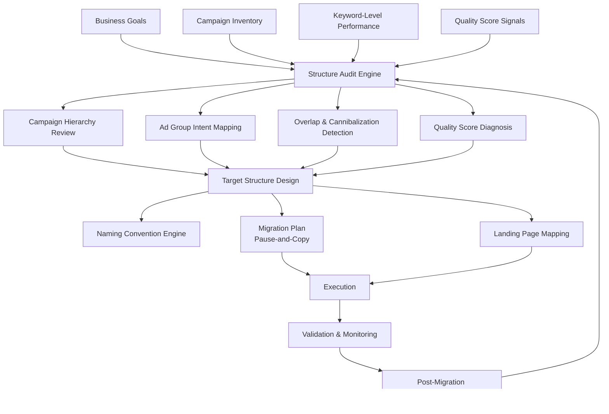

# Account Structure

Part of [Agent Skills™](https://github.com/itallstartedwithaidea/agent-skills) by [googleadsagent.ai™](https://googleadsagent.ai)

## Description

The Account Structure skill designs, audits, and migrates Google Ads campaign architecture so that every dollar of spend flows through a hierarchy that maximizes relevance and minimizes self-competition. It treats the account as an information architecture problem: campaigns are the top-level business segmentation, ad groups are the intent containers, and keywords are the demand signals that feed them. Getting this layer right is the highest-leverage action in paid search — no bidding strategy, budget allocation, or ad copy can fully compensate for a structure that fights itself.

Campaign hierarchy decisions are the first order of business. The skill helps marketers choose segmentation dimensions deliberately — product line, funnel stage, geography, or budget priority — and warns against organizing by match type alone, which fragments identical demand into competing auctions. At the ad group level, the skill enforces thematic discipline: 5-20 closely related keywords per ad group, with every keyword mapped to a single landing page intent. It also arbitrates the single-keyword-ad-group (SKAG) versus thematic debate. SKAGs are legacy architecture from the exact-match era; the modern recommendation is tight thematic ad groups using phrase and exact match, which preserve granularity without fragmenting quality score signal or multiplying management overhead.

The skill is equally focused on detecting structural rot. It scans for keyword overlap across campaigns and match types, identifies cannibalization before it inflates cost-per-click, and reads quality score patterns as restructuring signals — an ad group where all keywords score at or below 5 usually points to a mismatch between keyword intent, ad copy, and landing page. The built-in audit playbook runs the full lifecycle: inventory campaigns and ad groups, map keywords to intent clusters, detect overlaps, propose a target structure, and execute a pause-and-copy migration plan that preserves history and limits risk.

Finally, the skill enforces naming conventions that make accounts self-documenting at scale. A consistent scheme — market, campaign type, product line, funnel stage, bid strategy — turns a 200-campaign account from chaos into an addressable system that analysts, scripts, and the Buddy Agent can navigate programmatically.

## Use When

- User asks to "restructure my account" or "improve account structure"
- User mentions "campaign overlap" or "cannibalization between campaigns"
- User asks about "SKAGs" or "single keyword ad groups"
- User wants to "organize keywords into ad groups" or "clean up ad groups"
- User mentions "duplicate keywords" or "keywords in multiple campaigns"
- User asks to "audit account structure" or "run a structure review"
- User wants "naming conventions" or "consistent campaign naming"
- User mentions "ad groups with too many keywords" or "unrelated keywords in one ad group"
- User asks to "migrate campaigns" or "move keywords without losing history"

## Architecture



## Implementation

GAQL query that inventories the full keyword structure for overlap and quality score diagnosis:

```sql
SELECT
  campaign.id,
  campaign.name,
  ad_group.id,
  ad_group.name,
  ad_group_criterion.keyword.text,
  ad_group_criterion.keyword.match_type,
  ad_group_criterion.quality_score,
  metrics.impressions,
  metrics.clicks,
  metrics.cost_micros,
  metrics.conversions
FROM keyword_view
WHERE segments.date DURING LAST_30_DAYS
  AND campaign.status = 'ENABLED'
ORDER BY ad_group_criterion.keyword.text
```

Duplicate keyword detector (normalized keyword text appearing in more than one campaign):

```javascript
function detectDuplicateKeywords(keywordRows) {
  const buckets = new Map();

  for (const row of keywordRows) {
    const text = row.keyword.text.toLowerCase().trim();
    const key = `${text}|${row.keyword.matchType}`;
    if (!buckets.has(key)) buckets.set(key, []);
    buckets.get(key).push({
      campaignId: row.campaign.id,
      campaignName: row.campaign.name,
      adGroupName: row.adGroup.name,
      qualityScore: row.keyword.qualityScore,
      impressions: row.metrics.impressions,
      conversions: row.metrics.conversions
    });
  }

  return [...buckets.entries()]
    .filter(([, occurrences]) => new Set(occurrences.map(o => o.campaignId)).size > 1)
    .map(([key, occurrences]) => ({
      keyword: key.split('|')[0],
      matchType: key.split('|')[1],
      campaignCount: new Set(occurrences.map(o => o.campaignId)).size,
      occurrences,
      totalImpressions: occurrences.reduce((s, o) => s + o.impressions, 0),
      severity: classifyOverlapSeverity(occurrences)
    }))
    .sort((a, b) => b.totalImpressions - a.totalImpressions);
}

function classifyOverlapSeverity(occurrences) {
  const big = occurrences.some(o => o.impressions > 5000);
  const multiConverting = occurrences.filter(o => o.conversions > 0).length > 1;
  if (big && multiConverting) return 'CRITICAL'; // self-competing in the same auction
  if (occurrences.length > 2) return 'HIGH';
  return big ? 'MEDIUM' : 'LOW';
}
```

Intent-based keyword clustering engine that proposes thematic ad groups:

```javascript
async function clusterKeywordsByIntent(keywords, config) {
  const { landingPages, minClusterSize = 5, maxClusterSize = 20 } = config;

  // Step 1: assign each keyword to a landing page intent bucket
  const assigned = keywords.map(kw => ({
    ...kw,
    intent: resolveIntent(kw.text, landingPages)
  }));

  // Step 2: group keywords by intent bucket
  const clusters = new Map();
  for (const kw of assigned) {
    if (!clusters.has(kw.intent)) clusters.set(kw.intent, []);
    clusters.get(kw.intent).push(kw);
  }

  // Step 3: split oversized clusters on second-level root modifiers
  const adGroups = [];
  for (const [intent, members] of clusters) {
    for (const split of splitOversizedCluster(members, maxClusterSize)) {
      adGroups.push({
        adGroupName: `${config.campaignPrefix}_${slugify(intent)}`,
        landingPage: intent,
        keywords: split.map(k => k.text),
        matchTypeMix: recommendMatchTypes(split),
        estimatedClicks: split.reduce((s, k) => s + k.clicks, 0)
      });
    }
  }

  // Step 4: flag ad groups outside the 5-20 keyword band
  return {
    adGroups: adGroups.filter(g => g.keywords.length <= maxClusterSize),
    flags: adGroups
      .filter(g => g.keywords.length < minClusterSize)
      .map(g => ({ adGroup: g.adGroupName, issue: 'too few keywords — merge with sibling intent' }))
  };
}
```

## Integration with Buddy™ Agent

Account Structure is the organizational layer inside Buddy™ Agent. Every recommendation the platform generates — budget shifts, bid adjustments, ad copy rewrites — is tagged with campaign, ad group, and intent context derived from this skill's structure map. When Buddy™ detects duplicate keywords or a quality score collapse across an ad group, it surfaces a restructuring proposal with projected impact before the problem compounds into wasted spend.

Buddy™ runs the audit playbook on a scheduled cadence (monthly, or immediately after a broad quality score shift) and produces a diff between the actual structure and the target structure. It flags drift: renamed campaigns that broke the convention, ad groups that absorbed unrelated keywords, and new overlap introduced by expansion. Approved proposals trigger automated pause-and-copy migrations executed through the Google Ads API.

The skill coordinates with Keyword Research to keep intent clusters fed with fresh terms, and with Bid Strategy Optimization so structure changes land on the right bidding strategy — a thematic ad group with 15 keywords is a far better candidate for portfolio bidding than a SKAG ever was.

## Best Practices

1. Segment campaigns by product line, funnel stage, geography, or budget priority — never by match type alone, which fragments identical demand into competing auctions
2. Keep 5-20 closely related keywords per ad group, all mapping to a single landing page intent
3. Prefer tight thematic ad groups with phrase and exact match over SKAGs; exact-match-only SKAGs fragment the quality score signal that thematic groups concentrate
4. Run the duplicate-keyword overlap scan monthly; flag keywords appearing in two or more campaigns with over 5,000 impressions each as CRITICAL
5. Use quality score as a structural diagnostic: an ad group where every keyword scores 5 or below is an intent mismatch, not a bidding problem
6. Migrate with pause-and-copy: pause old ad groups, copy proven ads and extensions, and never delete campaigns outright before the replacement has demonstrated performance
7. Adopt a naming convention early — market > campaign type > product line > funnel stage > bid strategy — and enforce it with change-history scripts
8. Split ad groups that exceed 20 keywords on second-level root terms before they grow organically into broad buckets
9. Consolidate ad groups with fewer than 5 keywords or fewer than 15 conversions in 90 days into sibling thematics
10. Validate structure changes with a 2-4 week holdout: compare CPC, CTR, and CPA against the pre-migration baseline before declaring victory

## Platform Compatibility

| Platform | Supported |
|----------|-----------|
| Claude Code | ✅ |
| Cursor | ✅ |
| Codex | ✅ |
| Gemini | ✅ |

## Related Skills

- [Keyword Research](../keyword-research/) - Intent clusters are fed by keyword expansion and search term mining
- [Quality Score Optimization](../quality-score-optimization/) - Quality score signals drive restructuring priorities
- [Bid Strategy Optimization](../bid-strategy-optimization/) - Structure determines which bidding strategies are viable
- [Google Ads Audit](../google-ads-audit/) - The audit playbook is the input to every restructuring pass
- [Budget Optimization](../budget-optimization/) - Budget priority is a legitimate campaign hierarchy dimension
- [Geo Targeting](../geo-targeting/) - Geography is a common campaign segmentation dimension
- [Ad Scheduling](../ad-scheduling/) - Schedule-based splits add a layer of granularity to structure decisions
- [Conversion Tracking](../conversion-tracking/) - Restructuring must preserve conversion attribution integrity

## Keywords

account structure, campaign hierarchy, ad group organization, SKAG, single keyword ad groups, thematic ad groups, keyword clustering, campaign cannibalization, keyword overlap, account audit, naming conventions, pause and copy, quality score, campaign segmentation, ad group keywords, google ads structure

---

© 2026 [googleadsagent.ai™](https://googleadsagent.ai) | [Agent Skills™](https://github.com/itallstartedwithaidea/agent-skills) | MIT License