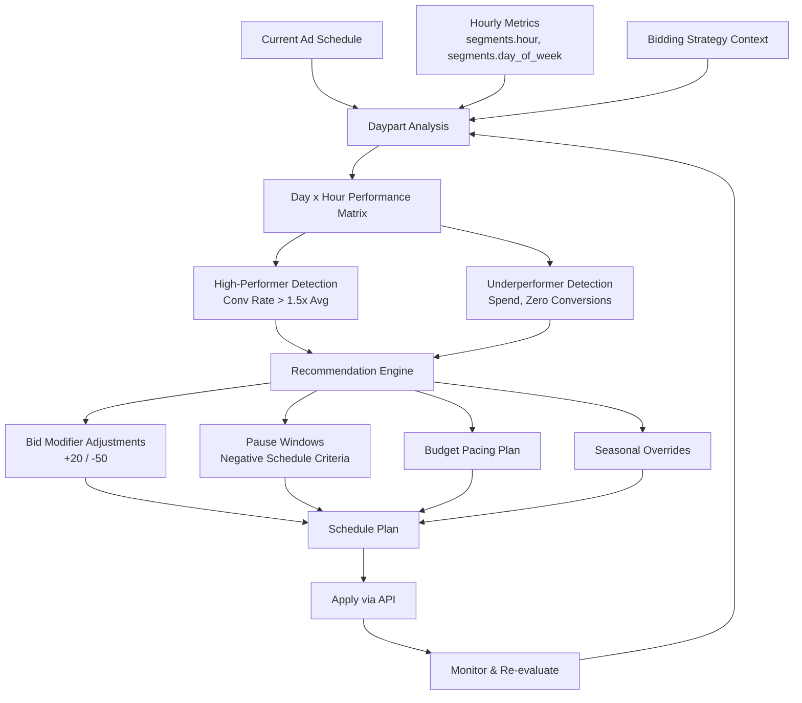

# Ad Scheduling

Part of [Agent Skills™](https://github.com/itallstartedwithaidea/agent-skills) by [googleadsagent.ai™](https://googleadsagent.ai)

## Description

The Ad Scheduling skill (dayparting) controls when ads run and how aggressively they bid within each day and hour. Google Ads supports custom schedules per day of week with hourly windows, each carrying its own bid modifier. Most accounts set one schedule and forget it — this skill turns ad scheduling into a continuous optimization loop that rebalances bid intensity toward the hours that actually convert.

The analysis engine segments performance by segments.day_of_week and segments.hour: impressions, clicks, conversions, and CPA for every day-hour cell. From that matrix it builds a daypart heatmap and a recommendation set. High-performing windows — conversion rate above 1.5x the account average with sufficient volume — earn a +20% bid adjustment. Chronic underperformers — meaningful spend with zero conversions — get a −50% adjustment or an outright pause via negative ad schedule criteria.

Dayparting must respect how the bidding strategy consumes it. Smart Bidding already models time of day as a feature: Target CPA, Target ROAS, and Maximize Conversions learn hourly curves automatically. Manual schedule bid adjustments under Smart Bidding are therefore most valuable as guardrails — capping exposure in known-bad windows — while Manual CPC accounts get the full benefit of aggressive daypart modifiers. Restricted schedules also starve Smart Bidding of learning data, so the default should be 24/7 coverage with modifiers, not off-hours.

Seasonal and operational events round out the skill: holiday-hour overrides (Black Friday, Christmas, industry events), weekend-versus-weekday schedule differences, and budget pacing that gives peak dayparts enough headroom to spend. Output is delivered as a day × hour heatmap with an execution-ready schedule plan.

## Use When

- User asks to "set up ad scheduling" or "do dayparting"
- User wants to know "when should my ads run" or "best hours to run ads"
- User asks for "bid adjustments by time of day" or "hourly bid modifiers"
- User mentions "weekend vs weekday performance"
- User asks to "pause ads at night" or "pause ads on weekends"
- User mentions "holiday hours" or "seasonal ad schedule"
- User wants a "daypart heatmap" or "performance by hour report"
- User asks to "pace budget by schedule" or "align budget with peak hours"
- User mentions "schedule bid adjustments" or "ad schedule criteria"

## Architecture



## Implementation

GAQL query for day-of-week and hour-level performance:

```sql
SELECT
  segments.day_of_week,
  segments.hour,
  metrics.impressions,
  metrics.clicks,
  metrics.cost_micros,
  metrics.conversions
FROM campaign
WHERE segments.date DURING LAST_30_DAYS
  AND campaign.status = 'ENABLED'
```

Daypart heatmap builder with recommendation logic:

```javascript
const DAY_ORDER = ['MONDAY', 'TUESDAY', 'WEDNESDAY', 'THURSDAY', 'FRIDAY', 'SATURDAY', 'SUNDAY'];

function buildDaypartRecommendations(hourlyRows, config) {
  const { minImpressions = 500, zeroConversionSpendFloor = 50, minConversions = 10 } = config;
  const accountConvRate = avg(hourlyRows.map(r => r.conversions / Math.max(r.clicks, 1)));

  const heatmap = [];
  const recommendations = [];

  for (const day of DAY_ORDER) {
    const dayRow = { day, hours: [] };
    for (let hour = 0; hour < 24; hour++) {
      const rows = hourlyRows.filter(r => r.dayOfWeek === day && r.hour === hour);
      const impressions = sum(rows, 'impressions');
      const clicks = sum(rows, 'clicks');
      const conversions = sum(rows, 'conversions');
      const cost = sum(rows, 'costMicros') / 1e6;
      const convRate = clicks > 0 ? conversions / clicks : 0;

      dayRow.hours.push({ hour, impressions, clicks, conversions, cost, convRate, cpa: conversions ? cost / conversions : null });
      if (impressions < minImpressions) continue;

      const ratio = accountConvRate > 0 ? convRate / accountConvRate : 0;

      if (conversions === 0 && cost >= zeroConversionSpendFloor) {
        recommendations.push({
          day, hour, action: 'PAUSE',
          rationale: `${cost.toFixed(0)} spent with zero conversions`
        });
      } else if (ratio >= 1.5 && conversions >= minConversions) {
        recommendations.push({
          day, hour, action: 'ADJUST', bidAdjustment: 20,
          rationale: `conv rate ${ratio.toFixed(1)}x account average`
        });
      } else if (ratio <= 0.5 && cost >= 100) {
        recommendations.push({
          day, hour, action: 'ADJUST', bidAdjustment: -50,
          rationale: `conv rate ${ratio.toFixed(2)}x average, spend ${cost.toFixed(0)}`
        });
      }
    }
    heatmap.push(dayRow);
  }

  return { heatmap, recommendations, accountConvRate };
}
```

Schedule plan builder that respects bidding strategy context:

```javascript
function buildSchedulePlan(recommendations, config) {
  const { bidStrategyType } = config;
  const smartBidding = ['TARGET_CPA', 'TARGET_ROAS', 'MAXIMIZE_CONVERSIONS', 'MAXIMIZE_CONVERSION_VALUE'].includes(bidStrategyType);

  // Smart Bidding models time of day itself: cap manual modifiers at +/-25%
  // and only pause chronic zero-conversion windows. Manual CPC gets full range.
  const cap = smartBidding ? 25 : 50;

  const plan = { criteria: [], notes: [] };
  if (smartBidding) {
    plan.notes.push('Smart Bidding already accounts for time of day; modifiers act as guardrails only');
  }

  for (const rec of recommendations) {
    if (rec.action === 'PAUSE') {
      plan.criteria.push({
        dayOfWeek: rec.day, startHour: rec.hour, endHour: rec.hour + 1,
        negative: true, rationale: rec.rationale
      });
    } else if (rec.action === 'ADJUST') {
      const modifier = Math.max(-cap, Math.min(cap, rec.bidAdjustment));
      plan.criteria.push({
        dayOfWeek: rec.day, startHour: rec.hour, endHour: rec.hour + 1,
        bidModifier: 1 + modifier / 100, rationale: rec.rationale
      });
    }
  }
  return plan;
}
```

## Integration with Buddy™ Agent

Ad Scheduling is the time intelligence layer in Buddy™ Agent. The platform computes the day × hour heatmap automatically from hourly metrics and surfaces schedule recommendations with expected impact — a +20% proposal for the Tuesday 9am window that converts at 1.8x the account average, a pause proposal for the 2am block that has burned $400 with zero conversions across 60 days.

Buddy™ manages the seasonal calendar on top of the schedule: holiday-hour overrides are pre-staged two to four weeks ahead, weekend schedules are tuned separately, and budget pacing is synchronized so peak dayparts have headroom. All recommendations are generated in the context of the account's bidding strategy, so Smart Bidding accounts receive guardrail-style proposals while Manual CPC accounts receive the full modifier range.

The skill coordinates with Geo Targeting because geo and daypart modifiers compose multiplicatively, and with Bid Strategy Optimization to keep the schedule plan aligned with the chosen bidding strategy. When daypart data exposes structural problems — an entire campaign that only works on weekdays — the skill feeds Account Structure with evidence for schedule-based campaign splits.

## Best Practices

1. Pull at least 30 days of hourly data (90 preferred) before changing a schedule — one week of daypart data is noise
2. Act only on day-hour cells with meaningful volume: roughly 500+ impressions or 10+ conversions per cell
3. Under Smart Bidding, prefer pausing chronic zero-conversion windows over aggressive negative modifiers — the algorithm models time of day itself
4. Manual CPC accounts are where daypart modifiers earn their keep; apply the full +20% / −50% range there
5. Apply +20% only to cells with conversion rate above 1.5x the account average AND sufficient conversion volume
6. Apply −50% or pause to cells with meaningful spend and zero conversions over 30+ days
7. Default to 24/7 coverage with modifiers rather than restricted hours — off-hours learning data is valuable to Smart Bidding
8. Tune weekends separately; weekend daypart curves differ from weekdays in most verticals
9. Pre-stage holiday overrides (Black Friday, Christmas, industry events) 2-4 weeks ahead and revert them after the event window
10. Pair daypart bid adjustments with budget pacing — peak hours need budget headroom or the modifiers cap out against budget exhaustion

## Platform Compatibility

| Platform | Supported |
|----------|-----------|
| Claude Code | ✅ |
| Cursor | ✅ |
| Codex | ✅ |
| Gemini | ✅ |

## Related Skills

- [Bid Strategy Optimization](../bid-strategy-optimization/) - Daypart modifiers must be composed with the account's bidding strategy
- [Geo Targeting](../geo-targeting/) - Geo and daypart bid modifiers are applied multiplicatively
- [Account Structure](../account-structure/) - Schedule-based campaign splits are a structural decision
- [Budget Optimization](../budget-optimization/) - Budget pacing by schedule gives peak dayparts headroom
- [Conversion Tracking](../conversion-tracking/) - Hourly conversion decisions depend on accurate attribution
- [Google Ads Audit](../google-ads-audit/) - Daypart analysis is a standard audit workstream
- [Remarketing Strategy](../remarketing-strategy/) - Remarketing campaigns benefit from daypart refinement
- [Search Term Analysis](../search-term-analysis/) - Hour-of-day and query analysis combine in conversion forensics

## Keywords

ad scheduling, dayparting, daypart analysis, ad schedule, time of day bidding, bid adjustments by hour, day of week targeting, hourly performance, daypart heatmap, weekend scheduling, holiday hours, schedule bid modifiers, ad schedule criteria, budget pacing, hourly cpa, segments.hour, segments.day_of_week, night pause

---

© 2026 [googleadsagent.ai™](https://googleadsagent.ai) | [Agent Skills™](https://github.com/itallstartedwithaidea/agent-skills) | MIT License