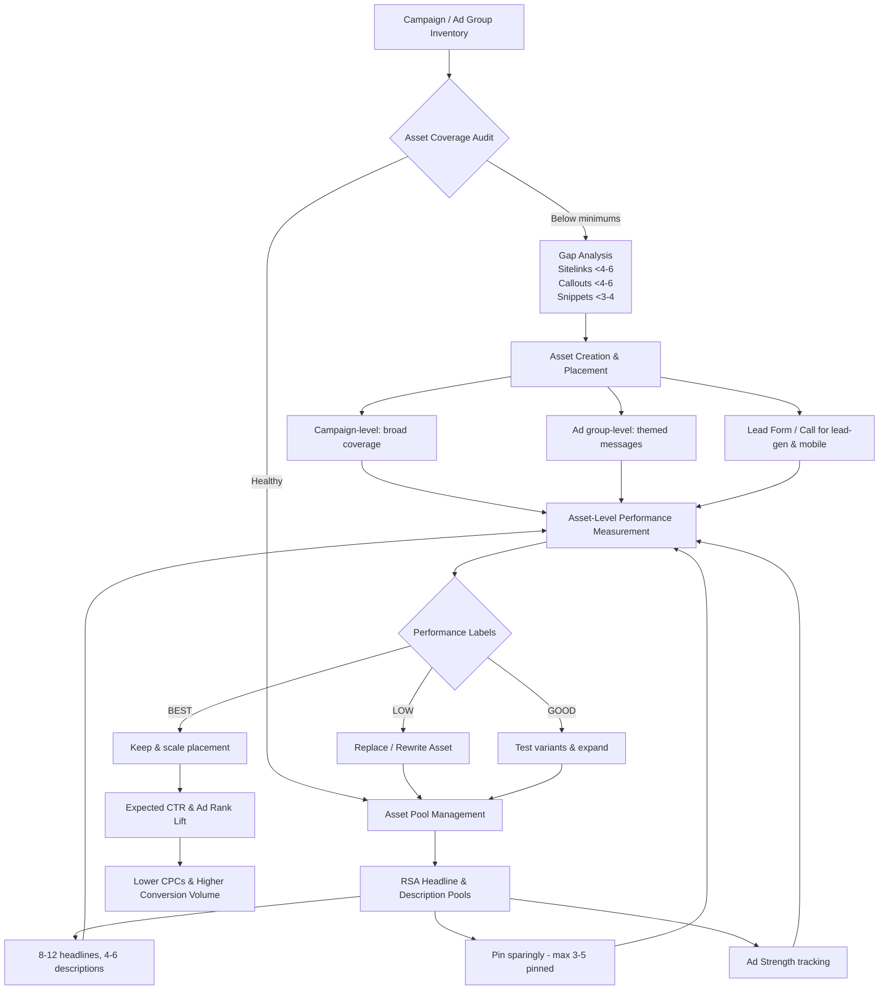

# Assets & Extensions

Part of [Agent Skills™](https://github.com/itallstartedwithaidea/agent-skills) by [googleadsagent.ai™](https://googleadsagent.ai)

## Description

The Assets & Extensions skill manages the complete asset inventory for Google Ads accounts. In modern Google Ads terminology, ad extensions are "assets" — sitelinks, callouts, call assets, structured snippets, lead forms, images, promotions, prices, and app extensions — plus the responsive search ad (RSA) headline and description pools. Assets are free ad real estate: they enlarge the ad unit, raise expected CTR, and directly contribute to Ad Rank, which means well-managed asset inventories win auctions at lower bids.

The skill covers asset inventory strategy: which assets to run, how many, and where. The working minimums are 4-6 sitelinks, 4-6 callouts, and 3-4 structured snippets per campaign. But volume alone is not enough — relevance matters more. Lead form assets matter for lead-gen accounts, call assets for mobile-heavy service businesses, promotion assets for ecommerce, price assets for competitive categories, and app extensions for app-install objectives. Assets are placed at campaign level for broad coverage or at ad group level when the message must differ by theme.

Performance measurement is a core pillar. Asset-level reports (via `ad_group_ad_asset_view` in GAQL) expose performance labels — LOW, GOOD, and BEST — for every headline, description, and extension. Combining assets that occupy different ad rows (sitelinks plus callouts plus snippets) compounds the Ad Rank lift, while a single pinning decision can cap Google's ability to assemble the best combination. The skill balances creative control (pinning headlines) against letting Google auto-optimize combinations, and tracks ad strength as the leading indicator of RSA health.

For the Buddy™ Agent platform this skill is the tactical layer between creative assets and bidding. Asset diversity feeds expected CTR, which feeds Quality Score and Ad Rank, which determines how aggressively bid strategies can perform. Mismanaged inventory — too few sitelinks, expired promotions, pinned headlines that stall testing — silently caps account performance even when bidding and budgets are optimal.

## Use When

- User asks to "add sitelinks" or "set up extensions" on campaigns
- User mentions "ad assets" or asks "why aren't my assets showing"
- User asks "why don't my sitelinks show" or "extensions not appearing"
- User mentions "ad strength" or wants to "improve headline combinations"
- User wants to "pin headlines" or "stop Google changing my ads"
- User asks about "lead form extensions" or "call extensions for mobile"
- User mentions "asset performance" or "LOW/GOOD/BEST labels"
- User wants "more clicks without raising bids" or "improve expected CTR"
- User asks "how many sitelinks should I have" or "asset best practices"

## Architecture



## Implementation

Asset performance reporting — pulls every asset with its performance label and field type:

```sql
SELECT
  campaign.name,
  ad_group.name,
  ad_group_ad_asset_view.field_type,
  asset.name,
  asset.type,
  asset.performance_label,
  metrics.impressions,
  metrics.clicks,
  metrics.ctr,
  metrics.cost_micros,
  metrics.conversions
FROM ad_group_ad_asset_view
WHERE segments.date DURING LAST_30_DAYS
  AND asset.type IN ('SITELINK', 'CALLOUT', 'CALL', 'STRUCTURED_SNIPPET', 'PROMOTION', 'IMAGE')
ORDER BY metrics.impressions DESC
LIMIT 500
```

Campaign-level asset inventory — the raw coverage map for gap analysis:

```sql
SELECT
  campaign.name,
  campaign_asset.field_type,
  asset.name,
  asset.type,
  asset.performance_label
FROM campaign_asset
WHERE campaign.status = 'ENABLED'
ORDER BY campaign.name, campaign_asset.field_type
```

JavaScript asset inventory gap analysis — flags campaigns below minimums and missing call assets on mobile-heavy service accounts:

```javascript
async function analyzeAssetInventory(customerId, profile) {
  const {
    minSitelinks = 4,      // best practice: 4-6 per campaign
    minCallouts = 4,       // best practice: 4-6 per campaign
    minSnippets = 3,       // best practice: 3-4 per campaign
    mobileShareThreshold = 0.60,
    isLeadGen = false,
    isEcommerce = false
  } = profile;

  const campaigns = await fetchCampaigns(customerId);          // id, name, mobileImpressionsShare
  const gaps = [];

  for (const campaign of campaigns) {
    const assets = await fetchCampaignAssets(customerId, campaign.id);
    const byType = groupByFieldType(assets);
    const fix = { campaign: campaign.name, issues: [] };

    const sitelinks = byType.SITELINK?.length ?? 0;
    const callouts = byType.CALLOUT?.length ?? 0;
    const snippets = byType.STRUCTURED_SNIPPET?.length ?? 0;
    const calls = byType.CALL?.length ?? 0;
    const leadForms = byType.LEAD_FORM?.length ?? 0;
    const promotions = byType.PROMOTION?.length ?? 0;

    if (sitelinks < minSitelinks) {
      fix.issues.push(`Add ${minSitelinks - sitelinks}+ sitelinks (target 4-6 per campaign)`);
    }
    if (callouts < minCallouts) {
      fix.issues.push(`Add ${minCallouts - callouts}+ callouts (target 4-6 per campaign)`);
    }
    if (snippets < minSnippets) {
      fix.issues.push(`Add ${minSnippets - snippets}+ structured snippets (target 3-4 per campaign)`);
    }
    if (isLeadGen && leadForms === 0) {
      fix.issues.push('Add a lead form asset - lead-gen campaigns see higher lead volume with forms');
    }
    if (isEcommerce && promotions === 0) {
      fix.issues.push('Add a promotion asset with a real end date to lift conversion rate during offers');
    }
    if (campaign.mobileImpressionsShare >= mobileShareThreshold && calls === 0) {
      fix.issues.push('Mobile impressions share is high but no call asset exists - add a CALL asset with a tracking number');
    }

    if (fix.issues.length > 0) gaps.push(fix);
  }

  return {
    gaps,
    gapCount: gaps.length,
    priority: gaps.length === 0 ? 'healthy' : 'assets_need_attention'
  };
}
```

RSA asset pool health — checks headline/description diversity and pinning balance:

```javascript
async function assessRsaHealth(customerId) {
  const rsaAssets = await fetchRsaAssetViews(customerId); // field_type, pinned, performance_label
  const report = [];

  for (const ad of rsaAssets) {
    const headlines = ad.headlines;       // HEADLINE + LONG_HEADLINE pool
    const descriptions = ad.descriptions; // DESCRIPTION pool
    const pinnedCount = headlines.filter(h => h.pinned).length;

    const health = {
      adId: ad.id,
      adStrength: ad.adStrength, // BELOW_AVERAGE | AVERAGE | GOOD | BEST
      headlineCount: headlines.length,
      descriptionCount: descriptions.length,
      pinnedHeadlineCount: pinnedCount
    };

    if (headlines.length < 8) health.flag = 'Add more headlines - target 8-12 for GOOD ad strength';
    else if (descriptions.length < 4) health.flag = 'Add more descriptions - target 4-6';
    else if (pinnedCount > Math.floor(headlines.length / 2)) health.flag = 'Too many pinned headlines - cap pins at 3-5 to let Google test combinations';
    else health.flag = 'healthy';

    report.push(health);
  }

  return { report, lowAdStrengthCount: report.filter(r => r.adStrength === 'BELOW_AVERAGE').length };
}
```

## Integration with Buddy™ Agent

Buddy™ runs the asset inventory audit on every account cycle. It compares each campaign's asset counts against the minimum thresholds, flags campaigns below 4-6 sitelinks or missing call assets on mobile-heavy accounts, and surfaces asset-level performance labels so LOW assets are replaced before they drag down expected CTR.

When the audit finds gaps, Buddy™ generates concrete fix lists — "add 2 sitelinks to Campaign X", "refresh 3 LOW callouts" — and coordinates with the Ad Copy Generation skill to draft replacement assets. After assets are added, Buddy™ monitors ad strength trends and CTR to confirm the expected CTR lift materialized.

Buddy™ also watches asset hygiene: expired promotions, paused sitelinks still attached, and pinned headlines that stall optimization. It schedules a 4-6 week refresh cadence so asset pools stay diverse, which keeps expected CTR and Ad Rank contributions compounding across the account.

## Best Practices

1. Maintain at least 4-6 sitelinks and 4-6 callouts per campaign; below these counts Google renders fewer extension rows and the Ad Rank lift fades
2. Always pair sitelinks with callouts and structured snippets — they render in different ad rows and compound the ad-unit expansion
3. Add lead form assets only on lead-gen campaigns whose landing page matches the form intent; mismatched forms hurt conversion rate
4. Add call assets with tracking numbers for service businesses where mobile impressions exceed 60% of total
5. Review asset performance labels weekly and replace LOW assets with GOOD/BEST variants; LOW headlines drag RSA CTR down 20-30%
6. Let Google auto-optimize headline/description combinations; pin at most 3-5 headlines and only when a message is legally or strategically required
7. Keep RSA pools at 8-12 headlines and 4-6 descriptions for GOOD-to-BEST ad strength; fewer than 8 headlines caps ad strength
8. Use promotion assets only for genuine offers with real end dates — expired or evergreen promos train users to ignore the row
9. Place assets at campaign level for broad coverage; move to ad group level only when the selling message differs by theme
10. Refresh the asset pool every 4-6 weeks; stale assets suffer fatigue and their performance labels decay to LOW

## Platform Compatibility

| Platform | Supported |
|----------|-----------|
| Claude Code | ✅ |
| Cursor | ✅ |
| Codex | ✅ |
| Gemini | ✅ |

## Related Skills

- [Ad Copy Generation](../ad-copy-generation/) - Headline and description pools feed RSA asset diversity
- [Quality Score Optimization](../quality-score-optimization/) - Diverse, relevant assets lift expected CTR and Quality Score
- [Conversion Tracking](../conversion-tracking/) - Asset performance is only meaningful with accurate conversion measurement
- [Attribution Modeling](../attribution-modeling/) - Understand how extension clicks contribute across the conversion path
- [Enhanced Conversions](../enhanced-conversions/) - Lead form and call assets depend on solid conversion capture
- [Google Ads Audit](../google-ads-audit/) - Asset coverage is a core dimension of any account audit
- [Bid Strategy Optimization](../bid-strategy-optimization/) - Strong assets raise expected CTR, unlocking more aggressive bidding

## Keywords

ad extensions, assets, sitelinks, callouts, call assets, structured snippets, lead form, promotion asset, price asset, app extension, responsive search ads, headline pinning, ad strength, asset performance label, ad rank, expected CTR, extension inventory, asset diversity, rsa headlines

---

© 2026 [googleadsagent.ai™](https://googleadsagent.ai) | [Agent Skills™](https://github.com/itallstartedwithaidea/agent-skills) | MIT License