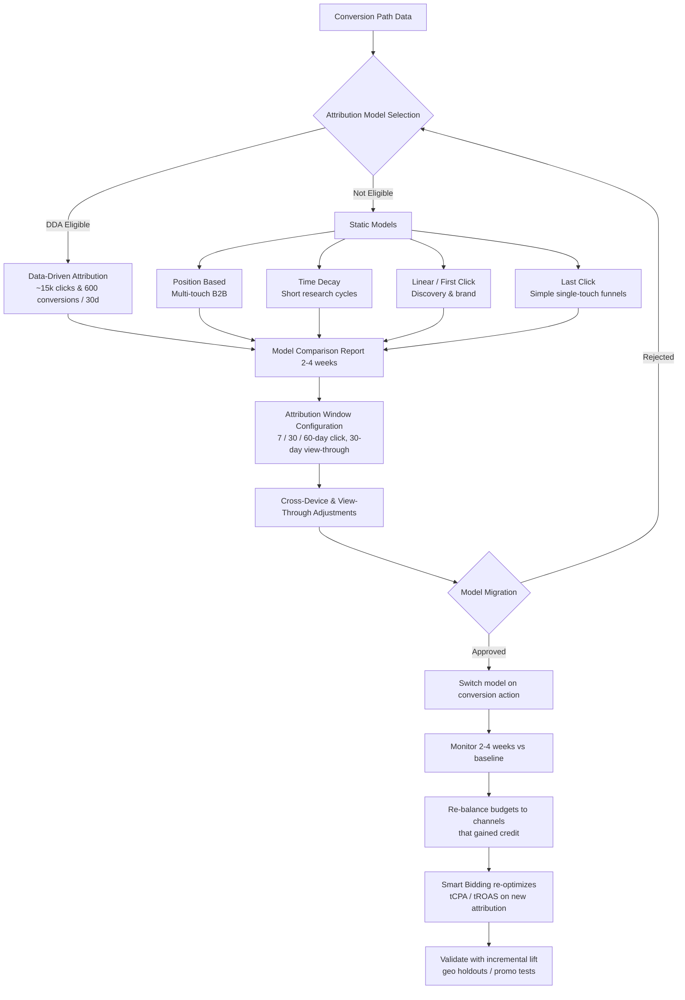

# Attribution Modeling

Part of [Agent Skills™](https://github.com/itallstartedwithaidea/agent-skills) by [googleadsagent.ai™](https://googleadsagent.ai)

## Description

The Attribution Modeling skill decides how conversion credit is distributed across the touchpoints that led to a sale or lead. The default last-click model assigns 100% of credit to the final interaction, which systematically undervalues upper-funnel channels — Display, YouTube, and research-stage Search keywords — and overvalues the last click before conversion. Google Ads offers first click, linear, time decay, position based, and data-driven models, and each one changes which campaigns and keywords look profitable. That changes budget allocation and bid decisions, so choosing the right model is a business decision, not a reporting nicety.

Data-driven attribution (DDA) is Google Ads' machine-learned model, which analyzes historical conversion paths and assigns credit based on each touchpoint's measured contribution. DDA requires roughly 15,000 clicks and 600 conversions in the trailing 30 days on Search campaigns to be eligible, and Google silently falls back to last-click attribution if volume drops below the threshold. When DDA is not yet eligible, the skill picks a static model from the funnel shape: position based for multi-touch B2B journeys, time decay for shorter research cycles, linear for uniform credit, and first click when top-of-funnel discovery is the strategic goal.

The skill also covers the supporting analysis stack: conversion path reports, assisted conversions, model comparison reports, cross-device conversions, and view-through conversions for Display and YouTube. Attribution windows (7-day, 30-day, or 60-day click-through; up to 30-day view-through) are configured per conversion action to match the real sales cycle. Because Smart Bidding strategies like tCPA and tROAS optimize against the currently configured attribution, changing the model changes bid behavior retroactively — migrations must be planned, monitored, and validated before budget shifts.

For the Buddy™ Agent platform, attribution is the lens through which every optimization is judged. An account with a poorly chosen model will misdirect budgets and reward the wrong keywords even when tracking, assets, and bids are technically sound. The skill pairs attribution choices with incremental-lift thinking: attribution reports credit, but only controlled experiments (geo holdouts, promo tests) prove causation.

## Use When

- User asks "which attribution model should I use" or "what attribution model is best"
- User mentions "data-driven attribution" or "DDA eligibility"
- User asks "why is search getting all the credit" or "why doesn't display get credit"
- User mentions "assisted conversions" or "conversion paths"
- User wants to "compare attribution models" before switching
- User asks about "conversion window" or "attribution window" settings
- User mentions "view-through conversions" or "cross-device conversions"
- User asks "is my ROAS real" or wants to measure "incremental lift"

## Architecture



## Implementation

Conversion path and assisted-conversion analysis per conversion action:

```sql
SELECT
  segments.conversion_action,
  segments.conversion_action_name,
  segments.ad_network_type,
  segments.device,
  metrics.conversions,
  metrics.all_conversions,
  metrics.assisted_conversions,
  metrics.assisted_conversion_value,
  metrics.cross_device_conversions,
  metrics.view_through_conversions,
  metrics.value_per_conversion
FROM campaign
WHERE segments.date DURING LAST_30_DAYS
  AND segments.conversion_action_name IS NOT NULL
ORDER BY metrics.assisted_conversions DESC
```

Model comparison on historical conversion paths — computes credit distribution per channel under each model:

```javascript
function compareAttributionModels(conversionPaths) {
  // conversionPaths: [{ conversions, value, touchpoints: [{ channel, timestampMs }] }]
  const models = {
    LAST_CLICK:    (path) => creditSingleTouch(path, 'last'),
    FIRST_CLICK:   (path) => creditSingleTouch(path, 'first'),
    LINEAR:        (path) => creditEvenly(path),
    TIME_DECAY:    (path) => creditTimeDecay(path, 7),      // 7-day half-life
    POSITION_BASED:(path) => creditPositionBased(path),     // 40% first, 40% last, 20% middle
    DATA_DRIVEN:   (path) => creditDataDriven(path)         // only when eligible
  };

  const results = {};
  for (const [name, fn] of Object.entries(models)) {
    const creditByChannel = new Map();
    for (const path of conversionPaths) {
      const credits = fn(path);
      for (const { channel, credit } of credits) {
        creditByChannel.set(channel, (creditByChannel.get(channel) ?? 0) + credit * path.value);
      }
    }
    results[name] = Object.fromEntries(creditByChannel);
  }

  const pathLengths = conversionPaths.map(p => p.touchpoints.length);
  const medianPathLength = median(pathLengths);

  return {
    models: results,
    diagnostics: {
      medianPathLength,
      singleTouchShare: conversionPaths.filter(p => p.touchpoints.length <= 1).length / conversionPaths.length,
      recommendation: medianPathLength >= 3
        ? 'POSITION_BASED (or DATA_DRIVEN when eligible) - multi-touch paths dominate'
        : 'LAST_CLICK or TIME_DECAY - most paths are single-touch'
    }
  };
}
```

Attribution migration checklist — gates DDA eligibility and stages the switch:

```javascript
function planAttributionMigration(config) {
  const { currentModel, candidateModel, clicks30d, conversions30d, salesCycleDays } = config;
  const ddaEligible = clicks30d >= 15000 && conversions30d >= 600; // trailing 30 days, Search

  if (candidateModel === 'DATA_DRIVEN' && !ddaEligible) {
    return {
      approved: false,
      reason: 'DDA requires ~15,000 clicks and 600 conversions in the last 30 days on Search; ' +
              'fall back to POSITION_BASED or TIME_DECAY until volume qualifies'
    };
  }

  return {
    approved: true,
    windowDays: salesCycleDays >= 60 ? 60 : salesCycleDays >= 30 ? 30 : 7,
    steps: [
      'Snapshot current-model reporting as the baseline',
      'Switch the attribution model on each conversion action (window stays matched to sales cycle)',
      'Monitor for 2-4 weeks without changing bids or budgets',
      'Compare assisted conversions, path data, and cost-per-conversion against baseline',
      'Re-balance budgets toward channels that gained credit (typically upper-funnel)',
      'Validate with an incremental lift experiment before finalizing tCPA/tROAS targets'
    ]
  };
}
```

## Integration with Buddy™ Agent

Buddy™ tracks DDA eligibility monthly for every account and alerts when volume drops below the ~15,000-click / 600-conversion threshold, because Google silently falls back to last-click attribution and the entire reporting picture shifts without warning. Buddy™ also detects attribution-window mismatches, such as a 7-day window on a conversion action whose sales cycle runs 45 days.

Buddy™ runs model comparisons on live conversion path data before any migration, projecting what each model would credit to Search, Display, YouTube, and Shopping. When a migration is approved, Buddy™ stages the switch, holds bids and budgets constant for the 2-4 week observation period, and then coordinates with the Bid Strategy Optimization skill so tCPA/tROAS targets are recalibrated against the new attribution reality.

Buddy™ continuously reconciles cross-device and view-through conversions into the model review so Display and YouTube awareness campaigns receive fair credit in budget decisions. Any anomalous shift — a channel suddenly gaining or losing 30%+ of credited conversions after a switch — triggers a rollback recommendation and a data-quality check.

## Best Practices

1. Use data-driven attribution when eligible (~15,000 clicks and 600 conversions in 30 days on Search); DDA outperforms static models on most qualified accounts
2. When DDA is ineligible, choose position based for multi-touch B2B funnels and time decay for short research cycles
3. Match the attribution window to the real sales cycle: 7-day click for impulse purchases, 30-day for standard ecommerce, 60-day for long B2B research
4. Keep attribution settings stable while Smart Bidding is learning — changing the model changes what tCPA/tROAS optimizes against retroactively
5. Run the model comparison report for 2-4 weeks before switching; review assisted conversions and path length distributions first
6. Configure attribution per conversion action, not account-wide; DDA eligibility and windows are evaluated per action
7. Expect credit to shift to upper-funnel touchpoints after leaving last click; re-balance Search/Display/YouTube budgets accordingly
8. Evaluate view-through conversions separately for Display and YouTube — they measure awareness lift, not direct response
9. Enable cross-device conversions to correct for mobile-to-desktop paths before judging any model's performance
10. Validate attribution conclusions with incremental lift experiments (geo holdouts or promo tests) — attribution reports credit, not causation

## Platform Compatibility

| Platform | Supported |
|----------|-----------|
| Claude Code | ✅ |
| Cursor | ✅ |
| Codex | ✅ |
| Gemini | ✅ |

## Related Skills

- [Enhanced Conversions](../enhanced-conversions/) - Accurate conversion measurement is the raw material attribution models consume
- [Conversion Tracking](../conversion-tracking/) - Conversion actions and windows are configured before any model is applied
- [Assets & Extensions](../assets-extensions/) - Extension clicks contribute to paths and deserve fair credit
- [Bid Strategy Optimization](../bid-strategy-optimization/) - tCPA/tROAS optimize against the configured attribution model
- [Budget Optimization](../budget-optimization/) - Model choice determines which campaigns look profitable enough to fund
- [Google Ads Audit](../google-ads-audit/) - Attribution and window settings are audited for model/cycle mismatches
- [Remarketing Strategy](../remarketing-strategy/) - Upper-funnel credit drives audience and retargeting investment

## Keywords

attribution model, data-driven attribution, DDA, last click, first click, linear attribution, time decay, position based, conversion paths, assisted conversions, view-through conversions, cross-device conversions, conversion window, attribution window, tCPA, tROAS, smart bidding, incremental lift, model comparison

---

© 2026 [googleadsagent.ai™](https://googleadsagent.ai) | [Agent Skills™](https://github.com/itallstartedwithaidea/agent-skills) | MIT License