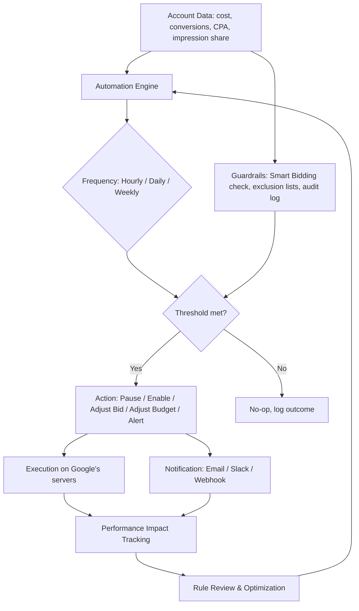

# Automation Rules

Part of [Agent Skills™](https://github.com/itallstartedwithaidea/agent-skills) by [googleadsagent.ai™](https://googleadsagent.ai)

## Description

The Automation Rules skill applies deterministic condition-to-action logic to routine campaign management decisions so media teams stop babysitting the account. Instead of manually scanning reports each morning, you define rules that pause underperforming keywords, pace budgets, adjust bids on a schedule, and page the right person when spend spikes. The skill covers both execution models Google offers: native automated rules (configured in the UI or via API, evaluated on Google's servers at a chosen frequency) and Google Ads scripts (JavaScript that runs daily or hourly on Google's infrastructure using the AdsApp object).

The core value is consistency at scale. An account with hundreds of campaigns and thousands of keywords generates far more threshold crossings than any human can review. Rules collapse that firehose into a small set of intentional actions: pause keywords with more than 50 clicks and zero conversions, alert when a campaign spends more than 2x its daily budget, reduce bids 20% when CPA exceeds 1.5x target for seven consecutive days. Each rule is a small, documented, reversible decision — and the aggregate effect is an account that self-corrects between human check-ins without ever making a risky unilateral change.

Expert nuance is where the skill earns its keep: automation must never fight Smart Bidding. On tCPA, tROAS, or Maximize campaigns, automated bid changes create feedback loops that corrupt the auction-time signal learning; the correct levers there are budget pacing, pausing unproductive traffic, and alerts — not bid micromanagement. Every rule ships with guardrails: preview or email-only mode first, an audit log of every fired action, exclusion lists so automation never touches brand campaigns or experiments, and a review cadence for rules that quietly stop firing.

This skill is built for media managers, agency teams, and in-house growth leads running always-on accounts who need 24/7 coverage between human check-ins and reproducible governance. Paired with the Buddy™ Agent platform, automated rules and scripts become the execution layer beneath the optimization recommendations, converting analysis into action on a schedule.

## Use When

- User asks to "set up automated rules" or "automate my Google Ads account"
- User says "pause keywords with no conversions" or "pause underperformers"
- User mentions "budget pacing" or "campaigns running out of budget by noon"
- User wants to "get an alert when spend spikes" or "notify our Slack channel"
- User asks for "scheduled bid adjustments" or "raise bids on weekends"
- User asks "can I use Google Ads scripts" or "write me a script for this"
- User mentions "rules fighting Smart Bidding" or "automation guardrails"
- User wants "zero-conversion pausing" or "automate negative keyword adds"
- User asks to "test a rule first" or "run a rule in preview mode"

## Architecture



## Implementation

GAQL queries the automation layer runs to identify rule candidates. Threshold comparisons happen in the rule or script layer — GAQL cannot compare a metric against a budget field or across date rows, so fetch raw fields and compute:

```gaql
-- Zero-conversion keyword candidates (pause trigger: >50 clicks, 0 conversions, 30d)
SELECT
  ad_group_criterion.keyword.text,
  ad_group_criterion.keyword.match_type,
  ad_group.name,
  campaign.name,
  campaign.bidding_strategy_type,
  metrics.clicks,
  metrics.conversions,
  metrics.cost_micros
FROM ad_group_criterion
WHERE
  ad_group_criterion.type = 'KEYWORD'
  AND ad_group_criterion.status = 'ENABLED'
  AND campaign.status = 'ENABLED'
  AND segments.date DURING LAST_30_DAYS

-- Budget pacing inputs (cost vs budget computed in JS)
SELECT
  campaign.name,
  campaign.bidding_strategy_type,
  campaign_budget.amount_micros,
  metrics.cost_micros,
  metrics.cost_per_conversion,
  metrics.impressions
FROM campaign
WHERE
  campaign.status = 'ENABLED'
  AND segments.date DURING LAST_7_DAYS
```

Automated rule definitions with Smart Bidding guardrails:

```javascript
// Native automated rule definition — run in preview mode first
const pauseZeroConversionRule = {
  name: 'Pause keywords with >50 clicks and 0 conversions (30d)',
  resourceType: 'KEYWORD',
  conditions: [
    { field: 'metrics.clicks', operator: 'GREATER_THAN', value: 50, timeRange: 'LAST_30_DAYS' },
    { field: 'metrics.conversions', operator: 'EQUALS', value: 0 }
  ],
  action: 'PAUSE',
  frequency: 'DAILY',
  notificationEmail: ['media@example.com'],
  preview: true // preview / send-email-only mode until verified
};

// Budget pacing rule with Smart Bidding guardrail
function buildBudgetPacingRule(campaign) {
  const smartBidding = ['TARGET_CPA', 'TARGET_ROAS', 'MAXIMIZE_CONVERSIONS', 'MAXIMIZE_CONVERSION_VALUE'];
  if (smartBidding.includes(campaign.biddingStrategyType)) {
    // Never automate aggressive changes on Smart Bidding campaigns — alert only
    return { action: 'ALERT_ONLY', reason: 'Smart Bidding active — do not override with rules' };
  }

  const dailyCost = campaign.costMicros / 1e6;
  const budget = campaign.budgetMicros / 1e6;
  if (dailyCost > budget * 2) {
    return { action: 'REDUCE_BUDGET', amount: budget * 0.8, alert: 'Spend exceeded 2x budget — reduced 20%' };
  }
  return { action: 'NOOP' };
}

// CPA trigger: reduce bid by 20% when CPA > 1.5x target for 7 consecutive days
function cpaOverTarget(cpaSeries, targetCpa) {
  return cpaSeries.length >= 7 && cpaSeries.every(c => c > targetCpa * 1.5);
}
```

Google Ads Script — budget pacing with Slack alerting, runs daily on Google's servers:

```javascript
// Google Ads Script: Scripts > New Script, set frequency Daily
function main() {
  const MAX_SPEND_MULTIPLIER = 2.0;
  const SLACK_WEBHOOK = 'https://hooks.slack.com/services/T000/B000/XXXX';

  const report = AdsApp.report(
    'SELECT campaign.name, campaign_budget.amount_micros, metrics.cost_micros ' +
    'FROM campaign WHERE campaign.status = ENABLED AND segments.date DURING TODAY'
  );

  const overSpenders = [];
  const rows = report.rows();
  while (rows.hasNext()) {
    const row = rows.next();
    const budget = Number(row['campaign_budget.amount_micros']) / 1e6;
    const cost = Number(row['metrics.cost_micros']) / 1e6;
    if (cost > budget * MAX_SPEND_MULTIPLIER) {
      overSpenders.push(row['campaign.name'] + ': $' + cost.toFixed(2) + ' vs $' + budget.toFixed(2));
    }
  }

  if (overSpenders.length > 0) {
    const message = 'Daily spend alert:\n' + overSpenders.join('\n');
    UrlFetchApp.fetch(SLACK_WEBHOOK, {
      method: 'post',
      payload: JSON.stringify({ text: message }),
      contentType: 'application/json'
    });
  }
}
```

## Integration with Buddy™ Agent

Automation Rules is the execution layer of the Buddy™ Agent platform. Buddy™ continuously evaluates account performance, and when it identifies a recurring pattern — a keyword family bleeding budget, a campaign pacing past 2x daily spend — it proposes a concrete rule or script with the exact threshold, frequency, and action. Every recommendation ships in preview mode by default, so a human approves the first firing before automation goes live.

Buddy™ enforces the guardrails this skill codifies. It refuses to generate bid-adjustment rules on Smart Bidding campaigns, maintains the audit log of every rule and script firing, and cross-checks rule candidates against the Policy Compliance and Quality Score skills so automation never amplifies a compliance or relevance problem. Rule firing history feeds back into monthly reviews, flagging rules that never fire (dead weight) or fire too often (misconfigured thresholds).

The platform also coordinates automation with the Budget Optimization and Bid Strategy Optimization skills: when a budget reallocation is approved, Buddy™ rewrites the pacing rules to match the new budget envelope and schedules the change for the next rule evaluation window.

## Best Practices

1. Run every new rule in preview or email-only mode for at least 3-7 days before it takes real action
2. Never create bid-adjustment rules on tCPA, tROAS, or Maximize campaigns — let Smart Bidding own the bid
3. Use LAST_30_DAYS windows for conversion-based pause rules; switch to 7 days only when a keyword has 30+ conversions of history
4. Prefer pausing over deleting — paused entities retain history and are one click from re-enabled
5. Keep a shared audit log of every rule: owner, threshold, frequency, action, and last firing time
6. Set daily frequency for budget pacing and weekly for CPA-based quality actions to reduce noise
7. Build exclusion lists so rules never touch brand campaigns, experiments, or sandbox accounts
8. Alert at 2x daily budget for a single day — that is noise; escalate at 3 consecutive days — that is a problem
9. Review rule firing history monthly; a rule that never fires is dead weight, one that fires daily is misconfigured
10. Wrap every script in try/catch, log with Logger.log, and email on exception so silent failures never accumulate

## Platform Compatibility

| Platform | Supported |
|----------|-----------|
| Claude Code | ✅ |
| Cursor | ✅ |
| Codex | ✅ |
| Gemini | ✅ |

## Related Skills

- [Budget Optimization](../budget-optimization/) - Budget pacing rules execute portfolio allocation decisions
- [Bid Strategy Optimization](../bid-strategy-optimization/) - Guardrails ensure rules never conflict with Smart Bidding
- [Conversion Tracking](../conversion-tracking/) - Rule thresholds are only as reliable as conversion measurement
- [Search Term Analysis](../search-term-analysis/) - Feed negative keyword rules from search term mining
- [Policy Compliance](../policy-compliance/) - Rules alert on and pause disapproved ads automatically
- [Campaign Launch Checklist](../campaign-launch-checklist/) - Post-launch monitoring rules begin where launch QA ends
- [Google Ads Audit](../google-ads-audit/) - Audits validate that automation is not degrading account health

## Keywords

automated rules, google ads scripts, budget pacing, pause underperformers, zero conversion pausing, bid adjustments, automated alerts, slack notification, rule guardrails, smart bidding conflict, preview mode, rule frequency, audit log, negative keyword automation, spend alert, adsapp, urlfetchapp, google ads automation, rule recipes

---

© 2026 [googleadsagent.ai™](https://googleadsagent.ai) | [Agent Skills™](https://github.com/itallstartedwithaidea/agent-skills) | MIT License