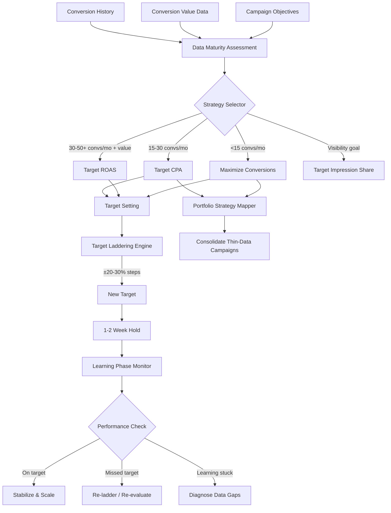

# Bid Strategy Optimization

Part of [Agent Skills™](https://github.com/itallstartedwithaidea/agent-skills) by [googleadsagent.ai™](https://googleadsagent.ai)

## Description

The Bid Strategy Optimization skill is the decision engine behind every bid Google Ads places. It evaluates an account's conversion-data maturity and selects the right Smart Bidding strategy — Target CPA, Target ROAS, Maximize Conversions, Maximize Conversion Value, or Target Impression Share — rather than guessing or copying what a peer account does. Getting this choice wrong wastes spend during learning phases and locks campaigns into targets that are structurally unachievable.

The skill encodes the data-readiness thresholds that separate one strategy from another. Target CPA is appropriate once a campaign sustains roughly 15-30 conversions per month; Target ROAS needs 30-50+ conversions per month plus reliable conversion value; Maximize Conversions is the on-ramp for thin-data campaigns; and Target Impression Share is reserved for brand, launch, and visibility-driven campaigns where conversion volume is not the primary objective. These thresholds are floors — Smart Bidding models degrade gracefully below them, but they cannot learn what the data never shows.

Beyond strategy selection, the skill covers target-setting methodology and transition management. Target ROAS should be seeded at approximately twice the account's current actual ROAS and laddered down in 20-30% steps as volume proves the ceiling. CPA targets follow the same laddering rhythm: move in steps of ±20-30%, then hold for 1-2 full weeks before touching anything again. Every transition — Manual CPC to Maximize Conversions, then to Target CPA — follows a checklist that protects the model from being destabilized mid-flight.

Finally, the skill defines the monitoring cadence that separates passive bid managers from active ones: cost-per-conversion versus target, impression share lost to budget versus rank, and learning status flags. When combined with portfolio bid strategies, it also lets thin-data campaigns share conversion signals across an account, which is frequently the fastest path to graduating a campaign onto a hard CPA target.

## Use When

- User asks to "switch to Smart Bidding" or "set up target CPA bidding"
- User mentions "target ROAS" or asks "what ROAS target should I set"
- User asks "why is my campaign still in learning mode"
- User wants to "change my bid strategy" or "move off manual CPC"
- User asks about "portfolio bid strategies" or "shared bid strategies"
- User mentions "bid strategy not hitting target" or "cost per conversion too high"
- User asks "should I use maximize conversions or target CPA"
- User wants to "optimize bids for impressions" or "set target impression share"
- User reports "bid strategy performance dropped after change"

## Architecture



## Implementation

Pull the bidding strategy configuration and performance state for every campaign:

```gaql
SELECT
  campaign.id,
  campaign.name,
  campaign.status,
  campaign.bidding_strategy_type,
  campaign_budget.amount_micros,
  campaign_budget.explicitly_shared,
  bidding_strategy.name,
  bidding_strategy.type,
  bidding_strategy.target_cpa.target_cpa_micros,
  bidding_strategy.target_roas.target_roas,
  bidding_strategy.target_impression_share.location,
  metrics.impressions,
  metrics.clicks,
  metrics.cost_micros,
  metrics.conversions,
  metrics.conversions_value,
  metrics.search_impression_share,
  metrics.search_impression_share_lost_budget,
  metrics.search_impression_share_lost_rank,
  metrics.average_cpc
FROM campaign
WHERE segments.date DURING LAST_30_DAYS
  AND campaign.status != 'REMOVED'
ORDER BY metrics.cost_micros DESC
```

Strategy selector with data-maturity thresholds and target seeding logic:

```javascript
function recommendBidStrategy(campaign, config = {}) {
  const monthlyConversions = campaign.conversions;
  const monthlyConvValue = campaign.conversionsValue;
  const actualROAS = campaign.cost > 0 ? campaign.convValue / campaign.cost : 0;

  const thresholds = {
    tCpaMin: config.tCpaMin ?? 15,
    tCpaComfortable: config.tCpaComfortable ?? 30,
    tRoasMin: config.tRoasMin ?? 30,
    tRoasComfortable: config.tRoasComfortable ?? 50,
    roasSeedMultiplier: config.roasSeedMultiplier ?? 2.0,
    ladderStep: config.ladderStep ?? 0.25
  };

  let strategy;
  let target;

  if (campaign.objective === 'VISIBILITY') {
    strategy = 'TARGET_IMPRESSION_SHARE';
    target = { location: 'ANYWHERE', budgetFraction: 0.8 };
  } else if (monthlyConversions >= thresholds.tRoasComfortable && monthlyConvValue > 0) {
    strategy = 'TARGET_ROAS';
    target = Math.round(actualROAS * thresholds.roasSeedMultiplier * 100) / 100;
  } else if (monthlyConversions >= thresholds.tCpaComfortable) {
    strategy = 'TARGET_CPA';
    target = Math.round((campaign.cost / campaign.conversions) * 100) / 100;
  } else if (monthlyConversions >= thresholds.tCpaMin) {
    strategy = 'TARGET_CPA';
    target = Math.round((campaign.cost / campaign.conversions) * 1.2 * 100) / 100;
  } else {
    strategy = 'MAXIMIZE_CONVERSIONS';
    target = null;
  }

  return { strategy, target, dataMaturity: classifyMaturity(monthlyConversions) };
}

function ladderTarget(currentTarget, direction, step = 0.25) {
  const delta = direction === 'down' ? 1 - step : 1 + step;
  const next = Math.round(currentTarget * delta * 100) / 100;
  return {
    nextTarget: next,
    holdWeeks: 2,
    rationale: `Step ${direction === 'down' ? 'down' : 'up'} ${step * 100}% and hold 1-2 weeks before reassessing`
  };
}

function isHealthyLearningState(campaign) {
  const today = new Date('2026-10-14');
  const daysSinceStrategyChange = (today - new Date(campaign.strategyChangeDate)) / 86400000;
  const impressions = campaign.impressions || 0;

  return {
    stillLearning: campaign.biddingStrategyType === 'TARGET_CPA' && daysSinceStrategyChange < 14,
    sufficientData: impressions >= 1000 || campaign.conversions >= 15,
    signal: impressions < 1000
      ? 'insufficient impression volume for model to stabilize'
      : 'model data sufficient, allow 1-2 weeks before adjusting target'
  };
}
```

## Integration with Buddy™ Agent

Bid Strategy Optimization is Buddy™ Agent's bidding brain. Buddy™ continuously ingests bidding strategy state from the account and flags campaigns that have drifted from their assigned strategy family — for example, a campaign running Target ROAS at 3.1x when the account benchmark is 1.8x with declining impression share. It surfaces these as prioritized recommendations with one-click transition plans.

When Buddy™ detects a campaign in a prolonged learning phase or a target that is repeatedly missed, it triggers the diagnostic workflow: data maturity re-check, conversion tracking audit, and competitor pressure signals from the Competitor Analysis skill. The recommended action always lands on a concrete step — ladder the target, change the strategy, or fix the tracking — never on vague advice.

The skill coordinates with Budget Optimization for portfolio bid strategy decisions and with Conversion Tracking to validate that the conversion volume feeding the algorithm is trustworthy. Buddy™ also enforces transition guardrails, blocking strategy changes on campaigns that have fewer than the documented conversion threshold or that changed strategy within the last 14 days.

## Best Practices

1. Never move a campaign to Target CPA with fewer than 15 conversions in the last 30 days; use Maximize Conversions below that threshold
2. Require 30-50+ conversions per month with stable conversion value before adopting Target ROAS
3. Seed Target ROAS at roughly 2x current actual ROAS and ladder down in 20-30% increments, never in one jump
4. Move CPA/ROAS targets in steps of ±20-30% and hold each step for 1-2 full weeks before reassessing
5. Limit manual bid adjustments (device, location, ad schedule, audiences) when Smart Bidding is active — Google recommends leaving optimization to the algorithm; cap manual adjustments at ±10-20% if they are unavoidable
6. Use portfolio bid strategies to aggregate conversion signals for campaigns that individually lack the 15-conversion monthly floor
7. Follow the transition path Manual CPC → Maximize Conversions (2-3 weeks) → Target CPA rather than jumping directly
8. Do not change strategy or target during the first 2 weeks of a learning phase; let the model exit learning before intervening
9. Watch impression share lost to rank — if it exceeds ~15% while cost-per-conversion is on target, the bid ceiling is limiting volume and the target should be raised
10. Monitor cost-per-conversion versus target weekly; a sustained 20%+ overshoot for two consecutive weeks warrants a target reset or strategy downgrade
11. Re-check bidding strategy fit after any conversion tracking change, since attribution shifts invalidate old thresholds

## Platform Compatibility

| Platform | Supported |
|----------|-----------|
| Claude Code | ✅ |
| Cursor | ✅ |
| Codex | ✅ |
| Gemini | ✅ |

## Related Skills

- [Conversion Tracking](../conversion-tracking/) - Smart Bidding is only as good as the conversion data feeding it
- [Campaign Experiments](../campaign-experiments/) - Validate strategy changes with 50/50 experiments before full rollout
- [Budget Optimization](../budget-optimization/) - Portfolio bid strategies and shared budgets shape the data pool for bidding
- [Google Ads Audit](../google-ads-audit/) - Audit bidding strategy health as part of the full account review
- [Quality Score Optimization](../quality-score-optimization/) - Poor quality scores inflate CPCs and distort bid-target economics
- [Search Term Analysis](../search-term-analysis/) - Remove irrelevant spend so the bid model optimizes against clean signals
- [Competitor Analysis](../competitor-analysis/) - Competitive pressure explains impression share lost to rank
- [Remarketing Strategy](../remarketing-strategy/) - Audience adjustments interact with Smart Bidding and need coordination

## Keywords

smart bidding, target cpa, target roas, maximize conversions, maximize conversion value, target impression share, bid strategy, bid adjustments, portfolio bid strategy, bid strategy transition, roas target setting, cpa target, learning phase, bid laddering, conversion thresholds, google ads bidding, automated bidding, manual cpc, bid management, impression share

---

© 2026 [googleadsagent.ai™](https://googleadsagent.ai) | [Agent Skills™](https://github.com/itallstartedwithaidea/agent-skills) | MIT License