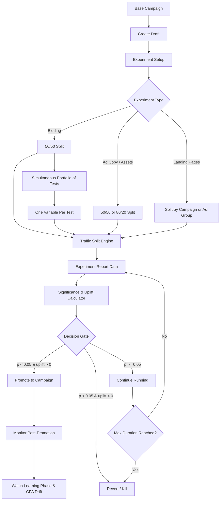

# Campaign Experiments

Part of [Agent Skills™](https://github.com/itallstartedwithaidea/agent-skills) by [googleadsagent.ai™](https://googleadsagent.ai)

## Description

The Campaign Experiments skill applies the drafts and experiments framework — plus disciplined A/B testing methodology — so account changes are proven before they are rolled out. Instead of gambling the whole account on a new bid strategy or ad copy, this skill splits traffic 50/50 between a base campaign and an experiment arm, measures the difference with significance testing, and promotes only the winners.

The framework covers the full experiment lifecycle: designing the draft from the base campaign, setting the experiment split, choosing a duration long enough for statistical validity, reading the experiment report, and deciding to promote or revert. Base campaign requirements are strict — the draft must be created from the current campaign state, the split should be 50/50 for bidding experiments, and the experiment must run until the losing variant accumulates enough conversions for the result to be meaningful.

Statistical rigor is the guardrail. A rule of thumb: run experiments 2-4 weeks, or until the losing variant has at least ~100 conversions — whichever comes later. A result that looks like a 30% uplift after three days is noise, not signal. The skill's significance calculator (a two-proportion z-test) makes the call quantitative: if the p-value stays above 0.05, the experiment continues; if it drops below, the result is actionable.

The testing roadmap prioritizes impact: bidding strategy experiments first, then ad copy and assets, then landing pages and audiences. This ordering reflects where the largest efficiency swings live. A bidding experiment can move cost-per-conversion by 20-40%; an ad copy test typically moves click-through rate by single digits. Running the roadmap in this order means the account accumulates wins in the order of leverage, and each tested layer builds on a stable foundation.

Guardrails protect the experiment's integrity — no mid-experiment changes to the base campaign, no experiments launched into seasonal spikes, and no split below 50/50 for bidding tests that needs symmetric data volume. When the experiment report shows a clear winner, the promote path is equally disciplined: promote the winning arm into the base campaign, retire the draft, and watch the first two weeks for learning phase disruption before declaring victory permanent. This is not a tool for the impatient — it is the mechanism that makes every account change evidence-based rather than opinion-based.

## Use When

- User asks to "test a new bid strategy" or "run an experiment on my campaign"
- User mentions "A/B test" or "split test" for ads, landing pages, or audiences
- User asks "should I promote this experiment" or "is this result significant"
- User wants to "try maximize conversions before switching over"
- User asks about "drafts and experiments" or "campaign drafts"
- User mentions "experiment report" or "uplift" or "significance"
- User wants to "revert an experiment" or "roll back a change"
- User asks "how long should my experiment run"
- User asks "is my experiment winner real or noise"

## Architecture



## Implementation

Pull experiment arms and their metrics from the base and experiment campaigns:

```gaql
SELECT
  campaign.id,
  campaign.name,
  campaign.experiment_type,
  experiment.name,
  experiment.status,
  experiment.start_date,
  experiment.end_date,
  metrics.impressions,
  metrics.clicks,
  metrics.cost_micros,
  metrics.conversions,
  metrics.conversions_value,
  metrics.ctr
FROM campaign
WHERE segments.date DURING LAST_30_DAYS
  AND campaign.experiment_type != 'UNKNOWN'
  AND campaign.status = 'ENABLED'
ORDER BY experiment.name, campaign.experiment_type
```

Statistical significance and uplift calculation for experiment decisions:

```javascript
function evaluateExperiment(base, trial, config = {}) {
  const minConversions = config.minConversions ?? 100;
  const minDays = config.minDays ?? 14;

  const baseConv = base.conversions, trialConv = trial.conversions;
  const baseClicks = base.clicks || base.impressions, trialClicks = trial.clicks || trial.impressions;
  const totalConv = baseConv + trialConv;

  if (baseConv < minConversions && trialConv < minConversions) {
    return { decision: 'CONTINUE', reason: `Losing variant has only ${Math.min(baseConv, trialConv)} conversions; need ~${minConversions}` };
  }

  const pBar = totalConv / (baseClicks + trialClicks);
  const se = Math.sqrt(pBar * (1 - pBar) * (1 / baseClicks + 1 / trialClicks));
  const z = (trialConv / trialClicks - baseConv / baseClicks) / se;
  const pValue = 2 * (1 - normalCdf(Math.abs(z)));

  const baseCPA = base.costMicros / 1e6 / baseConv;
  const trialCPA = trial.costMicros / 1e6 / trialConv;
  const uplift = baseCPA > 0 ? (baseCPA - trialCPA) / baseCPA : 0;

  if (pValue < 0.05 && uplift > 0.05) {
    return { decision: 'PROMOTE', pValue, uplift, trialCPA, baseCPA };
  }
  if (pValue < 0.05 && uplift < -0.05) {
    return { decision: 'REVERT', pValue, uplift, trialCPA, baseCPA };
  }
  return { decision: 'CONTINUE', pValue, uplift, reason: 'p >= 0.05; keep running until significance or max duration' };
}

function normalCdf(x) {
  const t = 1 / (1 + 0.2316419 * Math.abs(x));
  const d = 0.3989423 * Math.exp(-x * x / 2);
  const p = d * t * (0.3193815 + t * (-0.3565638 + t * (1.781478 + t * (-1.821256 + t * 1.330274))));
  return x > 0 ? 1 - p : p;
}

function planExperimentRoadmap(account) {
  return [
    { order: 1, type: 'BIDDING_STRATEGY', split: 0.5, minDurationWeeks: 2, note: 'Highest leverage; test target CPA vs maximize conversions first' },
    { order: 2, type: 'AD_COPY_AND_ASSETS', split: 0.5, minDurationWeeks: 2, note: 'Test one variable at a time; hold everything else constant' },
    { order: 3, type: 'LANDING_PAGE', split: 0.5, minDurationWeeks: 3, note: 'Coordinate with conversion tracking to capture micro-conversions' },
    { order: 4, type: 'AUDIENCE', split: 0.5, minDurationWeeks: 2, note: 'Segment by audience to avoid overlap cannibalization' }
  ].filter(s => s.type !== 'BIDDING_STRATEGY' || account.biddingMaturityScore > 0.5);
}

function promoteExperiment(experiment) {
  return {
    action: 'PROMOTE_TO_CAMPAIGN',
    baseCampaignId: experiment.baseCampaignId,
    trialCampaignId: experiment.trialCampaignId,
    steps: [
      'Apply winning configuration to the base campaign',
      'Remove the experiment draft and trial campaign',
      'Set a 2-week monitoring window for learning phase and CPA drift',
      'Log the result in the account experiment ledger for future reference'
    ],
    postPromotion: { checkAfterDays: 14, metric: 'cost_per_conversion', tolerance: 0.2 }
  };
}
```

Reading the experiment report requires looking at both arms symmetrically: the control and the experiment arm must be compared on the same metric family (impressions, clicks, cost, conversions, conversion value) over the same date range. The significance percentage in the Google Ads UI is a two-tailed test — a result below ~95% confidence is not a winner regardless of how large the raw uplift looks.

## Integration with Buddy™ Agent

Campaign Experiments is Buddy™ Agent's validation gate. Before Buddy™ ever recommends a full campaign change — a new bid strategy, rewritten ad copy, or a landing page swap — it routes the change through an experiment plan and refuses to promote changes that skipped testing when the account has enough volume to test meaningfully. Every experiment Buddy™ proposes comes with a computed minimum duration and the conversion threshold the losing variant must reach.

During the run, Buddy™ polls the experiment arms on its standard cadence and updates the decision gate as data accumulates. It computes the z-test significance automatically and surfaces a traffic-light status: green (promote), red (revert), amber (keep running). When an experiment is promoted, Buddy™ keeps monitoring the post-promotion learning phase so the win does not evaporate under real-world volume.

The skill coordinates with Bid Strategy Optimization to make sure bidding experiments use 50/50 splits and clean transition plans, with Ad Copy Generation to define the single variable under test, and with Landing Page Audit to confirm the page variant being tested is not a structural outlier. Buddy™ also enforces the seasonal guardrail — experiments scheduled into known demand spikes are automatically deferred.

## Best Practices

1. Always create experiments from a draft of the current base campaign; never mutate the base mid-experiment
2. Use a 50/50 split for bidding strategy experiments; 50/50 or 80/20 for ad copy and asset tests
3. Run experiments 2-4 weeks minimum, or until the losing variant accumulates at least ~100 conversions — whichever is later
4. Do not launch experiments during seasonal spikes, promotional windows, or known demand shocks — the external variance will swamp the signal
5. Change exactly one variable per experiment; testing two changes at once makes the winning driver unidentifiable
6. Promote only when p < 0.05 and the uplift is directionally meaningful (at least ~5% improvement in the primary metric)
7. Never change the base campaign's bids, budget, or targeting while its experiment arm is live — it breaks the controlled comparison
8. For bidding experiments, avoid splits below 50/50 — asymmetric traffic starves the model and lengthens the learning phase
9. After promoting, watch the first 2 weeks for learning phase disruption and CPA drift before declaring the change permanent
10. Keep a testing roadmap: bidding first, then ad copy/assets, then landing pages — the highest-leverage variable gets tested first
11. Monitor the experiment report's significance percentage weekly, not daily — daily readings oscillate and cause premature kill/promote decisions
12. Run multiple experiments in parallel only if they touch different campaigns — parallel tests on the same campaign interfere with each other's traffic splits

## Platform Compatibility

| Platform | Supported |
|----------|-----------|
| Claude Code | ✅ |
| Cursor | ✅ |
| Codex | ✅ |
| Gemini | ✅ |

## Related Skills

- [Bid Strategy Optimization](../bid-strategy-optimization/) - Bidding experiments validate strategy transitions before full rollout
- [Ad Copy Generation](../ad-copy-generation/) - Provides the ad variants that experiments test as the single variable
- [Landing Page Audit](../landing-page-audit/) - Ensures landing page variants tested are structurally sound
- [Conversion Tracking](../conversion-tracking/) - Significance calculations are only valid with accurate conversion measurement
- [Google Ads Audit](../google-ads-audit/) - Audit findings become the experiment backlog
- [Budget Optimization](../budget-optimization/) - Budget shifts should be tested as experiments, not applied wholesale
- [Audience Targeting](../audience-targeting/) - Audience tests need clean segmentation to avoid overlap
- [Quality Score Optimization](../quality-score-optimization/) - Experiment outcomes should be read alongside quality score movement

## Keywords

campaign experiments, drafts and experiments, google ads experiments, a/b testing, split testing, experiment report, statistical significance, uplift, p-value, promote experiment, revert experiment, experiment split, 50/50 split, experiment duration, test roadmap, bidding experiments, ad copy testing, landing page testing, controlled experiment, experiment guardrails

---

© 2026 [googleadsagent.ai™](https://googleadsagent.ai) | [Agent Skills™](https://github.com/itallstartedwithaidea/agent-skills) | MIT License