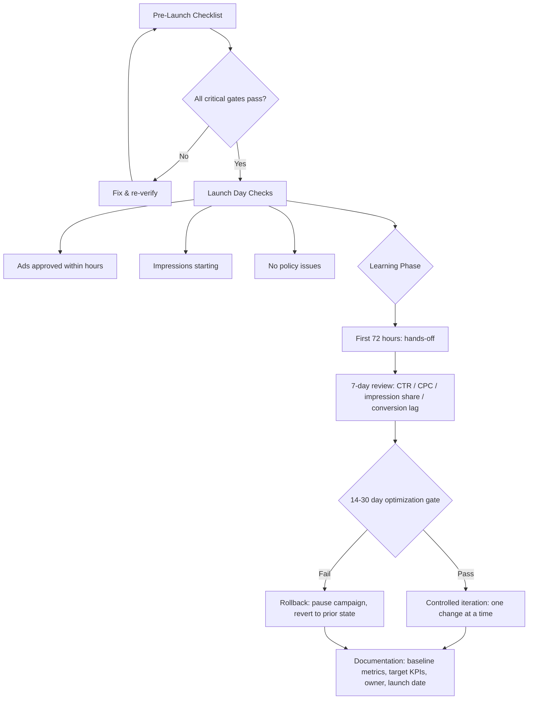

# Campaign Launch Checklist

Part of [Agent Skills™](https://github.com/itallstartedwithaidea/agent-skills) by [googleadsagent.ai™](https://googleadsagent.ai)

## Description

The Campaign Launch Checklist skill turns new campaign launches from a gamble into a gated process. Launch day is the highest-risk moment in any account: one misconfigured element — the wrong conversion action mapped to the bidding strategy, a budget shared with the wrong campaign, a missing negative list — can waste budget, stall the learning phase, or poison weeks of performance data. This skill provides a structured pre-launch, launch-day, and post-launch framework with owners, pass/fail gates, and explicit rollback paths.

The pre-launch checklist is the bulk of the work and the source of most launch failures. Conversion tracking must be verified with real test conversions before the campaign exists — no tracking, no launch. Conversion actions must be mapped to the right bidding strategy with exactly one primary conversion per Smart Bidding goal. Budget needs headroom: start at the expected daily budget, not an aspirational number, and avoid sharing a budget across campaigns with different goals. Keywords and audiences load before launch so machine learning starts with signal, not silence. Extensions, responsive assets, ad schedule, geo targeting, URL tracking parameters consistent with GA4, consent mode, negative keyword lists, brand exclusions, and — for Performance Max — complete asset groups all get a named owner and a pass/fail check.

Launch day is verification, not configuration: ads approved within hours, impressions starting to accrue, no policy issues on the review clock. The learning phase then runs on a defined cadence — Smart Bidding takes 7-14 days to stabilize, and the first 72 hours are hands-off except for critical fixes like tracking or policy failures. The 7-day review looks at CTR, CPC, impression share, and conversion lag. The 14-30 day gate is the first point where optimization is legitimate, and even then one change at a time.

The skill closes the loop with a rollback plan (pause the campaign, revert to the previous winning configuration) and launch documentation: baseline metrics, target KPIs, owner, and launch date recorded before a single impression serves. Built for media managers and agency teams who launch frequently, it makes every launch repeatable, reviewable, and reversible.

## Use When

- User asks to "launch a new campaign" or "set up a campaign from scratch"
- User says "check my campaign before launch" or "is my campaign ready to go live"
- User asks "why is my campaign in learning phase" or "when can I start optimizing"
- User mentions "no conversions after launch" or "conversion tracking not firing"
- User wants a "post-launch monitoring plan" or a "launch checklist"
- User asks about "rollback" or "how to pause a campaign safely"
- User is "launching a PMax campaign" or "launching a Search campaign"
- User wants to "verify the campaign is serving" or "check impressions after launch"

## Architecture



## Implementation

GAQL queries to verify the campaign is actually serving after launch. `campaign.serving_status` returns SERVING, LEARNING, RARELY_SERVED, ENDED, or PAUSED — a launch is not complete until status is SERVING or LEARNING with impressions accruing:

```gaql
-- Serving verification: run 3-6 hours after launch, then daily for 7 days
SELECT
  campaign.name,
  campaign.status,
  campaign.serving_status,
  campaign.advertising_channel_type,
  campaign_budget.amount_micros,
  metrics.impressions,
  metrics.clicks,
  metrics.cost_micros,
  metrics.average_cpc,
  metrics.ctr
FROM campaign
WHERE
  campaign.name = 'YOUR_CAMPAIGN'
  AND segments.date DURING LAST_3_DAYS

-- Ad approval and policy check after launch
SELECT
  ad_group_ad.ad.id,
  ad_group_ad.policy_summary.approval_status,
  ad_group_ad.policy_summary.review_status,
  metrics.impressions,
  campaign.name
FROM ad_group_ad
WHERE
  campaign.name = 'YOUR_CAMPAIGN'
  AND segments.date DURING LAST_3_DAYS
```

Checklist validator — returns pass/fail with owners and blocks launch on critical failures:

```javascript
const LAUNCH_CHECKLIST = [
  { id: 'CT-01', area: 'Conversion Tracking', check: 'Test conversion fired via test mode', owner: 'Analytics Lead', critical: true },
  { id: 'CT-02', area: 'Conversion Tracking', check: 'Single primary conversion action mapped to bidding strategy', owner: 'Analytics Lead', critical: true },
  { id: 'BD-01', area: 'Budget', check: 'Daily budget set at expected spend with headroom, not shared across campaigns', owner: 'Media Manager', critical: true },
  { id: 'BD-02', area: 'Bidding', check: 'Bidding strategy configured (tCPA / tROAS / Manual)', owner: 'Media Manager', critical: true },
  { id: 'KW-01', area: 'Keywords', check: 'Keywords and match types loaded, no zero-volume orphans', owner: 'Media Manager', critical: false },
  { id: 'AS-01', area: 'Assets', check: 'Extensions and responsive assets added (min 15 headlines, 4 descriptions)', owner: 'Creative Lead', critical: false },
  { id: 'TG-01', area: 'Targeting', check: 'Ad schedule and geo targets set', owner: 'Media Manager', critical: false },
  { id: 'TR-01', area: 'Tracking', check: 'URL tracking params consistent with GA4 (UTM schema)', owner: 'Analytics Lead', critical: true },
  { id: 'CM-01', area: 'Consent', check: 'Consent mode configured on site', owner: 'Developer', critical: true },
  { id: 'NG-01', area: 'Negatives', check: 'Negative keyword list applied, brand exclusions set', owner: 'Media Manager', critical: false },
  { id: 'PM-01', area: 'PMax', check: 'Asset group completeness (headlines, images, videos)', owner: 'Media Manager', critical: true },
  { id: 'PC-01', area: 'Policy', check: 'Pre-flight policy check passed (no prohibited terms)', owner: 'Compliance', critical: true }
];

function validateLaunchChecklist(results) {
  const failed = LAUNCH_CHECKLIST.filter(item => !results[item.id]);
  const blocked = failed.some(f => f.critical);
  return {
    pass: failed.length === 0,
    launchBlocked: blocked,
    failedItems: failed.map(f => ({ id: f.id, area: f.area, owner: f.owner, critical: f.critical })),
    summary: `${LAUNCH_CHECKLIST.length - failed.length}/${LAUNCH_CHECKLIST.length} passed`
  };
}
```

Learning-phase and rollback logic:

```javascript
function learningPhaseGate(campaign, daysSinceLaunch) {
  if (daysSinceLaunch <= 3) {
    return { action: 'HANDS_OFF', note: 'No edits — critical fixes only (tracking, policy)' };
  }
  if (daysSinceLaunch <= 14) {
    return {
      action: 'MONITOR',
      metrics: ['ctr', 'cpc', 'impressionShare', 'conversionLag'],
      note: 'Smart Bidding learning phase: 7-14 days. Evaluate only after 15+ conversions.'
    };
  }
  if (campaign.conversions < 15) {
    return { action: 'EXTEND_LEARNING', note: 'Fewer than 15 conversions — do not judge CPA/ROAS yet' };
  }
  return { action: 'OPTIMIZATION_GATE_OPEN', note: 'One change at a time, then wait 7 days' };
}

function rollbackPlan(campaign, previousState) {
  return {
    step1: { action: 'PAUSE_CAMPAIGN', resource: campaign.id, timing: 'Immediate' },
    step2: { action: 'REVERT_BIDDING', to: previousState.biddingStrategy, timing: 'After pause confirmed' },
    step3: { action: 'REVERT_BUDGET', to: previousState.budgetMicros / 1e6, timing: 'Within 24 hours' },
    step4: { action: 'DOCUMENT', note: `Record reason: ${campaign.rollbackReason}` },
    reactivation: 'Re-launch only after root cause fixed and checklist re-verified'
  };
}
```

## Integration with Buddy™ Agent

Campaign Launch Checklist is Buddy™ Agent's quality gate for everything that goes live. When a launch plan enters the platform, Buddy™ pulls the actual campaign configuration and compares it field by field against the checklist — real budget vs. expected spend, primary conversion mapped, negatives applied, assets complete — and produces a launch readiness report with the responsible owner named for every failed item. Critical failures block the launch; non-critical ones are tracked with a due date.

After launch, Buddy™ runs the monitoring cadence automatically: a serving check a few hours in, a daily approval-status check, a 72-hour hands-off enforcement window that suppresses optimization recommendations, a 7-day performance review against baseline CTR, CPC, and impression share, and the 14-30 day optimization gate. Recommendations during learning phase are held or downgraded to "monitor" so the campaign is never touched at the worst possible moment.

The platform coordinates the full launch lifecycle: the Conversion Tracking skill validates the tracking layer, the Policy Compliance skill runs pre-flight checks, the Automation Rules skill stands up post-launch alert rules, and the PMax Optimization and Assets & Extensions skills verify asset completeness. Every launch's baseline metrics and target KPIs are recorded in the documentation layer, giving future launches and the Google Ads Audit skill a reference point for measuring what actually happened.

## Best Practices

1. Never launch before conversion tracking is verified with a real test conversion — most launch failures trace to this
2. Map exactly one primary conversion action to the bidding strategy; avoid double-counted secondary goals
3. Set budget at expected daily spend with headroom, and never share a budget across campaigns with different goals
4. Do not touch the campaign for the first 72 hours except critical fixes (tracking or policy failures)
5. Expect a 7-14 day Smart Bidding learning phase; judge CPA/ROAS only after 15+ conversions
6. At the 7-day mark review CTR, CPC, impression share, and conversion lag before any bid changes
7. Confirm ads are approved within hours of launch — a disapproval stalls the learning clock from day one
8. Keep a rollback plan documented before launch: pause the campaign, revert to the previous winning configuration
9. Record baseline metrics, target KPIs, owner, and launch date at launch — you cannot measure lift without them
10. Use the 14-30 day gate for optimization: one change at a time, then wait 7 days before evaluating

## Platform Compatibility

| Platform | Supported |
|----------|-----------|
| Claude Code | ✅ |
| Cursor | ✅ |
| Codex | ✅ |
| Gemini | ✅ |

## Related Skills

- [Conversion Tracking](../conversion-tracking/) - Verified tracking is the number one pre-launch gate
- [Policy Compliance](../policy-compliance/) - Pre-flight policy checks prevent launch-day disapprovals
- [Keyword Research](../keyword-research/) - Feed launch keywords and match types from research
- [Audience Targeting](../audience-targeting/) - Load audiences before launch for faster learning
- [Assets & Extensions](../assets-extensions/) - Complete asset and extension sets before launch
- [Performance Max Optimization](../pmax-optimization/) - PMax asset group completeness gates PMax launches
- [Enhanced Conversions](../enhanced-conversions/) - Consent mode and enhanced conversions configure pre-launch
- [Automation Rules](../automation-rules/) - Post-launch monitoring rules begin at the 7-day mark

## Keywords

campaign launch checklist, pre-launch checklist, launch day checks, post-launch monitoring, learning phase, smart bidding learning, 72 hour rule, conversion tracking verification, test conversion, budget headroom, impression share, conversion lag, rollback plan, launch documentation, campaign QA, new campaign setup, optimization gate, brand exclusions, negative keyword list, launch gate

---

© 2026 [googleadsagent.ai™](https://googleadsagent.ai) | [Agent Skills™](https://github.com/itallstartedwithaidea/agent-skills) | MIT License