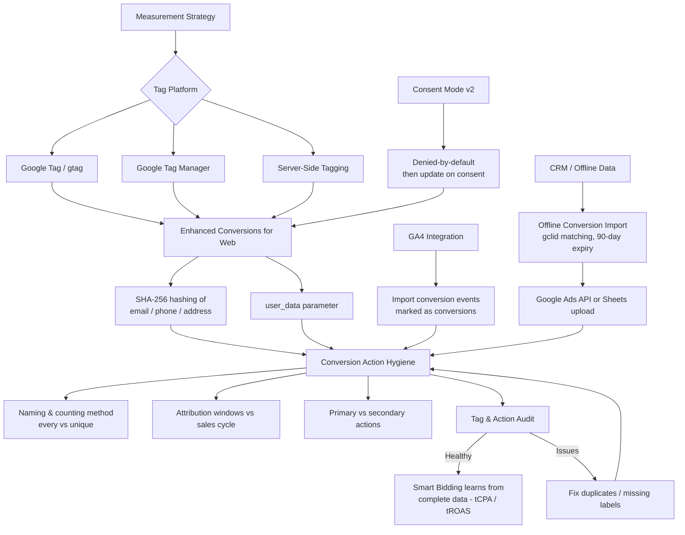

# Enhanced Conversions

Part of [Agent Skills™](https://github.com/itallstartedwithaidea/agent-skills) by [googleadsagent.ai™](https://googleadsagent.ai)

## Description

The Enhanced Conversions skill modernizes conversion measurement for a post-cookie world. Cookie deprecation and privacy regulations mean a growing share of conversions are invisible to Google Ads, and Smart Bidding is flying blind on incomplete data. Enhanced conversions close that gap by sending hashed first-party data — email, phone number, and address — to Google Ads, which matches it against signed-in user activity to recover conversions that tags alone never see. Industry experience puts the recovery at roughly 10-20%+ of previously unmeasured conversions. Two flavors exist: enhanced conversions for web (hashed user-provided data captured on-site) and enhanced conversions for leads (CRM data matched back to the ad click).

The skill covers the full implementation stack: Google tag (gtag) vs. Google Tag Manager vs. server-side tagging, consent mode v2 (ad_storage, ad_user_data, ad_personalization, analytics_storage) with denied-by-default configuration, and client-side SHA-256 hashing so raw PII never leaves the browser. The right tag architecture prevents the classic failure modes — duplicate gtag loads, missing conversion IDs, and wrong tag types — that silently corrupt bid learning.

Measurement modernization also means integrating Google Analytics 4 with Google Ads and importing offline conversions. GA4 conversion events are imported as conversion actions (the event must be marked as a conversion inside the GA4 property first). Offline conversions flow from the CRM via the Google Ads API or Google Sheets upload, matched on the gclid captured in a hidden form field. Both channels feed a single, clean conversion action table.

Conversion action hygiene is the final pillar: consistent naming, the right counting method ("every" for purchases with transaction_id dedupe, "unique" for lead forms and calls), attribution windows matched to the sales cycle, and a clear primary vs. secondary action hierarchy so Smart Bidding optimizes one true goal. Done right, enhanced conversions plus offline import can recover 10-20%+ of lost signal and let tCPA/tROAS learn from complete data.

## Use When

- User asks to "set up enhanced conversions" or "enable enhanced conversions"
- User mentions "enhanced conversions for leads" or "leads measurement"
- User asks about "consent mode" or "consent mode v2"
- User says "conversions are underreported" or "missing conversions"
- User wants to "import GA4 conversions" or "link GA4 to Google Ads"
- User asks for "offline conversion import" or "upload CRM conversions"
- User mentions "gclid" or "click ID matching"
- User asks "Google tag or Google Tag Manager" or "which tag should I use"
- User mentions "duplicate conversion actions" or "conversion action cleanup"

## Architecture



## Implementation

Conversion action inventory with measurement settings — the hygiene audit query:

```sql
SELECT
  conversion_action.name,
  conversion_action.type,
  conversion_action.category,
  conversion_action.status,
  conversion_action.counting_type,
  conversion_action.primary_for_conversion_goal,
  conversion_action.enhanced_conversions_enabled,
  conversion_action.attribution_model_settings.attribution_model,
  conversion_action.attribution_model_settings.lookback_window,
  conversion_action.value_settings.default_value,
  conversion_action.value_settings.currency_code,
  conversion_action.tag_snippets
FROM conversion_action
WHERE conversion_action.status = 'ENABLED'
ORDER BY conversion_action.name
```

JavaScript conversion-action audit — flags duplicates, counting mismatches, window gaps, and missing enhanced conversions:

```javascript
async function auditConversionActions(customerId, salesCycleDays = 30) {
  const actions = await fetchConversionActions(customerId); // GAQL query above
  const issues = [];
  const seen = new Map();

  for (const action of actions) {
    const key = action.name.trim().toLowerCase();
    if (seen.has(key)) {
      issues.push({ severity: 'high', issue: `Duplicate conversion action name "${action.name}" (ids ${seen.get(key)} and ${action.id}) - rename or merge` });
    }
    seen.set(key, action.id);

    if (action.category === 'LEAD' && action.countingType !== 'ONE_PER_CLICK') {
      issues.push({ severity: 'medium', issue: `${action.name}: lead actions should count unique conversions (ONE_PER_CLICK), not every event` });
    }

    const windowDays = lookbackWindowToDays(action.lookbackWindow); // DAYS_7/30/60
    if (windowDays < salesCycleDays) {
      issues.push({ severity: 'medium', issue: `${action.name}: ${action.lookbackWindow} window is shorter than the ${salesCycleDays}-day sales cycle` });
    }

    if (action.enhancedConversionsEnabled !== true) {
      issues.push({ severity: 'high', issue: `${action.name}: enhanced conversions disabled - enable to recover ~10-20%+ of unmeasured conversions` });
    }

    if (action.type === 'GOOGLE_ANALYTICS_4' && !action.ga4EventVerified) {
      issues.push({ severity: 'medium', issue: `${action.name}: verify the GA4 event is marked as a conversion in the linked property` });
    }
  }

  const primaries = actions.filter(a => a.primaryForConversionGoal);
  if (primaries.length > 4) {
    issues.push({ severity: 'high', issue: `${primaries.length} primary actions - Smart Bidding sees multiple goals; keep 1-4 primaries and mark the rest secondary` });
  }

  return { actions, issues, primaryCount: primaries.length, health: issues.length === 0 ? 'healthy' : 'needs_attention' };
}
```

Consent mode v2 with enhanced conversions — denied-by-default, updated on consent, hashed user data:

```javascript
// Consent Mode v2 - default state before consent is collected
gtag('consent', 'default', {
  ad_storage: 'denied',
  ad_user_data: 'denied',
  ad_personalization: 'denied',
  analytics_storage: 'denied'
});

// Called when the user grants consent
gtag('consent', 'update', {
  ad_storage: 'granted',
  ad_user_data: 'granted',
  ad_personalization: 'granted',
  analytics_storage: 'granted'
});

// Enhanced conversions for web - hashed first-party data, never raw PII
gtag('set', 'user_data', {
  email: sha256Hash(emailField.value),
  phone_number: sha256Hash(phoneField.value),
  address: {
    first_name: sha256Hash(firstNameField.value),
    last_name: sha256Hash(lastNameField.value),
    street: sha256Hash(streetField.value),
    city: sha256Hash(cityField.value),
    region: sha256Hash(regionField.value),
    postal_code: sha256Hash(postalCodeField.value),
    country: sha256Hash(countryField.value)
  }
});

gtag('event', 'conversion', {
  send_to: 'AW-123456789/abc123XYZ',
  value: 250.00,
  currency: 'USD',
  transaction_id: 'ORD-10442' // deduplicates "every" counting
});
```

## Integration with Buddy™ Agent

Buddy™ audits the conversion action table every account cycle using the GAQL inventory query. It flags duplicate actions, counting methods that don't match the funnel ("every" on a lead form), attribution windows shorter than the sales cycle, and conversion actions missing enhanced conversions — each fix is prioritized by expected signal recovery.

When tag infrastructure needs modernization, Buddy™ walks the account through the Google tag vs. GTM vs. server-side decision, checks for duplicate gtag loads and stale event snippets, and validates consent mode v2 is deployed with denied-by-default before any consent banner goes live. It then verifies GA4-imported events are marked as conversions in the linked property.

Buddy™ also supervises the offline conversion pipeline: gclid capture in hidden form fields, upload cadence (within 24-48 hours of the CRM event), and match rates. Clean, complete measurement flows straight into the Bid Strategy Optimization and Attribution Modeling skills, so tCPA/tROAS learn from every recoverable conversion instead of a cookie-limited slice.

## Best Practices

1. Enable enhanced conversions for web first — it requires no new tag, just the user_data parameter, and typically recovers ~10-20%+ of unmeasured conversions
2. Deploy consent mode v2 with denied-by-default before the consent banner goes live; updating to granted preserves signal while honoring privacy
3. Hash all first-party data client-side with SHA-256 before sending; never transmit raw PII to Google
4. Standardize on one tag platform (Google tag / gtag) — Google tag plus GTM plus legacy snippets causes duplicate fires and inflated counts
5. Verify GA4-imported events are marked "conversion" inside the GA4 property before enabling them as conversion actions
6. Capture gclid in a hidden form field and upload offline conversions within 24-48 hours of the CRM event; keep the gclid valid for 90 days
7. Set counting to ONE_PER_CLICK (unique) for lead forms and calls; use ALL_CONVERSIONS (every) for purchases with transaction_id dedupe
8. Match conversion windows to the sales cycle (7/30/60-day click) and cap view-through windows at 30 days
9. Keep 1-4 primary conversion actions account-wide and mark the rest secondary so Smart Bidding optimizes a single true goal
10. Audit tags quarterly: duplicate gtag loads, missing conversion IDs, wrong tag types, and stale events all silently corrupt bid learning

## Platform Compatibility

| Platform | Supported |
|----------|-----------|
| Claude Code | ✅ |
| Cursor | ✅ |
| Codex | ✅ |
| Gemini | ✅ |

## Related Skills

- [Attribution Modeling](../attribution-modeling/) - Attribution decisions are only as good as the conversion data beneath them
- [Conversion Tracking](../conversion-tracking/) - Enhanced conversions are the modernization layer on top of conversion actions
- [Assets & Extensions](../assets-extensions/) - Lead form and call assets depend on solid conversion capture
- [Bid Strategy Optimization](../bid-strategy-optimization/) - tCPA/tROAS need complete measurement to learn correctly
- [Landing Page Audit](../landing-page-audit/) - Form fields and gclid capture live on the landing page
- [Google Ads Audit](../google-ads-audit/) - Tag and conversion action hygiene is a foundational audit category
- [Budget Optimization](../budget-optimization/) - Recovered conversions change the ROAS picture and budget pacing

## Keywords

enhanced conversions, enhanced conversions for leads, consent mode v2, GA4 integration, google tag, gtag, google tag manager, server-side tagging, offline conversion import, gclid, crm upload, conversion action, counting method, attribution window, primary conversion, secondary conversion, first-party data, sha-256 hashing, conversion measurement

---

© 2026 [googleadsagent.ai™](https://googleadsagent.ai) | [Agent Skills™](https://github.com/itallstartedwithaidea/agent-skills) | MIT License