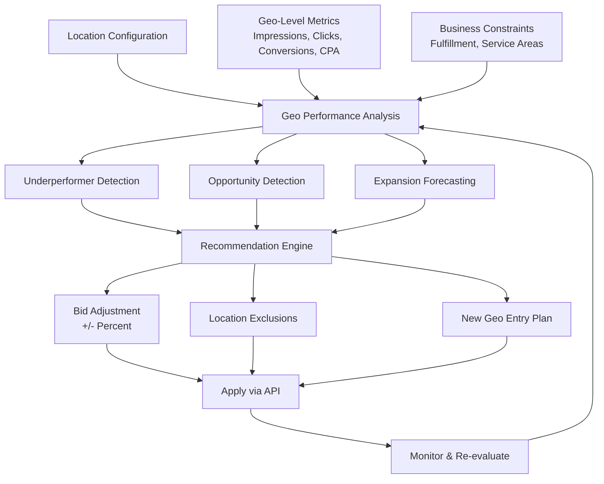

# Geo Targeting

Part of [Agent Skills™](https://github.com/itallstartedwithaidea/agent-skills) by [googleadsagent.ai™](https://googleadsagent.ai)

## Description

The Geo Targeting skill turns location-level performance data into profit decisions. Google Ads offers targeting at country, region, city, postal code, airport, and radius granularity, plus location groups that bundle geo targets by business intent. Most accounts treat location as a one-time setup decision — this skill treats it as a continuous optimization surface where spend is rebalanced across geographies as conversion economics shift.

The analysis engine segments performance by geography using the segments.geo_target fields — impressions, clicks, conversions, and cost-per-acquisition for every location the account touches. It identifies underperformers with hard thresholds: locations that burned meaningful spend with zero conversions, and locations whose CPA exceeds two times the account average. For those geos the skill recommends bid adjustment reductions or outright location exclusions, applied through campaign_criterion bid modifiers and negative location criteria.

Location bid adjustments are the primary lever. The skill models how +/− percentage modifiers interact with bidding strategy: under Manual CPC they are direct levers on the auction, while under Smart Bidding they act as guardrails and business constraints — Smart Bidding already optimizes per location, so aggressive manual modifiers can fight the algorithm. Expansion into new profitable geos follows a forecast-based approach: estimate demand, impression share, and CPA before committing budget, then ramp in observation mode.

For local businesses the skill drives radius targeting (typically 5-20 miles from store locations), location groups, and coordination with location assets and location extensions. Online CPA must be reconciled against store-visit and offline conversions, since a click that drives foot traffic is invisible to the account unless conversion tracking captures it.

## Use When

- User asks to "optimize geo targeting" or "improve location targeting"
- User mentions "location bid adjustments" or "geo bid modifiers"
- User asks "which locations are underperforming" or "wasted spend by region"
- User wants to "exclude locations" or "add negative locations"
- User asks to "expand into new cities" or "enter new geographic markets"
- User mentions "radius targeting" or "targeting near my stores"
- User asks about "location extensions" or "local presence"
- User wants a "geo performance report" or "performance by city"
- User mentions "location options" or "people in my targeted locations"

## Architecture



## Implementation

GAQL query for city-level geo performance (90-day window for stable CPA signals):

```sql
SELECT
  campaign.id,
  segments.geo_target_most_specific_location,
  metrics.impressions,
  metrics.clicks,
  metrics.cost_micros,
  metrics.conversions
FROM campaign
WHERE segments.date DURING LAST_90_DAYS
  AND campaign.status = 'ENABLED'
```

GAQL query for current location targets and their bid modifiers:

```sql
SELECT
  campaign.name,
  campaign_criterion.location.geo_target_constant_id,
  campaign_criterion.bid_modifier,
  campaign_criterion.negative,
  campaign_criterion.status
FROM campaign_criterion
WHERE campaign_criterion.type = 'LOCATION'
  AND campaign.status = 'ENABLED'
```

Geo bid adjustment and exclusion recommendation engine:

```javascript
async function recommendGeoBidAdjustments(customerId, config) {
  const { minSpend = 150, lookbackDays = 90 } = config; // $150 spend floor
  const accountAvgCpa = await getAccountAverageCpa(customerId, lookbackDays);
  const geoRows = await getGeoPerformance(customerId, lookbackDays);

  const recommendations = [];
  for (const geo of geoRows) {
    const spend = geo.costMicros / 1e6;
    if (spend < minSpend) continue; // insufficient data to act

    const cpa = geo.conversions > 0 ? spend / geo.conversions : Infinity;
    const ratio = cpa / accountAvgCpa;

    if (geo.conversions === 0) {
      recommendations.push({
        location: geo.location, action: 'EXCLUDE',
        rationale: `${spend.toFixed(0)} spent with zero conversions in ${lookbackDays} days`
      });
    } else if (ratio >= 3) {
      recommendations.push({
        location: geo.location, action: 'EXCLUDE', bidAdjustment: null,
        rationale: `CPA ${ratio.toFixed(1)}x account average`
      });
    } else if (ratio >= 2) {
      recommendations.push({
        location: geo.location, action: 'ADJUST', bidAdjustment: -50,
        rationale: `CPA ${ratio.toFixed(1)}x account average`
      });
    } else if (ratio >= 1.5) {
      recommendations.push({
        location: geo.location, action: 'ADJUST', bidAdjustment: -20,
        rationale: `CPA ${ratio.toFixed(1)}x account average`
      });
    } else if (ratio <= 0.7 && geo.conversions >= 20) {
      recommendations.push({
        location: geo.location, action: 'ADJUST', bidAdjustment: 20,
        rationale: `CPA ${ratio.toFixed(1)}x average with ${geo.conversions} conversions`
      });
    } else {
      recommendations.push({
        location: geo.location, action: 'HOLD', bidAdjustment: 0,
        rationale: 'within acceptable CPA band'
      });
    }
  }
  return recommendations;
}

// Forecast-based expansion planner for entering new profitable geos
async function forecastGeoExpansion(customerId, candidateGeos, config) {
  const { targetCpa, minForecastConversions = 15 } = config;

  return Promise.all(candidateGeos.map(async geo => {
    const forecast = await getGeoForecast(customerId, geo.geoTargetConstantId, {
      weeks: 8, dailyBudget: config.probeBudget
    });
    const projectedCpa = forecast.estimatedCostMicros / 1e6 / Math.max(forecast.estimatedConversions, 1);

    return {
      location: geo.name,
      projectedConversions: forecast.estimatedConversions,
      projectedCpa,
      viable: forecast.estimatedConversions >= minForecastConversions && projectedCpa <= targetCpa * 1.2,
      entryMode: 'OBSERVATION', // probe 30 days before committing bid adjustments
      probeBudget: config.probeBudget,
      nextStep: projectedCpa <= targetCpa
        ? 'promote to active targeting with +10% modifier'
        : 'continue observation; revisit next cycle'
    };
  }));
}
```

## Integration with Buddy™ Agent

Geo Targeting is the geographic intelligence layer in Buddy™ Agent. The platform continuously monitors location-level performance and triggers recommendations the moment a location crosses a spend or CPA threshold — an exclusion proposal when a city burns budget with zero conversions, a −20% adjustment when CPA drifts past 1.5x the account average. Each recommendation ships with one-click apply through the Google Ads API.

Buddy™ coordinates geo decisions with local presence. For local businesses it recommends radius rings around store locations, flags stores that need location assets, and reconciles online CPA with store-visit conversions so geo decisions reflect true foot-traffic economics. Expansion proposals include forecast-based demand estimates and ramp budgets for observation-mode entry.

The skill pairs with Bid Strategy Optimization so geo modifiers are applied correctly under each bidding strategy, and with Account Structure when location-based campaign splits are the right hierarchy. Geo adjustments are also composed with ad schedule modifiers — a bad region during a bad hour is double jeopardy.

## Best Practices

1. Never exclude a location on fewer than 15 conversions or 90 days of data — small samples regress to the mean and exclusions are hard to reverse
2. Set a minimum spend floor (roughly $150-300 or 2x account CPA) before acting on any geo signal
3. Under Smart Bidding, use geo bid adjustments as guardrails for business constraints (margin by region, logistics zones) rather than as CPA levers
4. Review the location options setting: "people in or regularly in your targeted locations" excludes searchers physically outside your targets and keeps geo reports clean
5. Analyze at the most specific location level — state-level averages hide city-level winners and losers
6. Use radius targeting of 5-20 miles for local businesses and layer city targeting at the edges for coverage
7. Exclude locations you cannot fulfill (no shipping, no service) regardless of apparent CPA — those "conversions" become refunds
8. Expand into new geos with forecasts first, then enter in observation mode with modest budgets before applying bid adjustments
9. Reconcile geo online CPA with store-visit conversions for local campaigns; clicks that drive foot traffic are invisible without offline tracking
10. Re-audit geo performance monthly — competitor entry, seasonality, and fulfillment changes shift the geo profit map

## Platform Compatibility

| Platform | Supported |
|----------|-----------|
| Claude Code | ✅ |
| Cursor | ✅ |
| Codex | ✅ |
| Gemini | ✅ |

## Related Skills

- [Account Structure](../account-structure/) - Location segmentation is a core campaign hierarchy dimension
- [Bid Strategy Optimization](../bid-strategy-optimization/) - Geo bid adjustments must be composed correctly with each bidding strategy
- [Ad Scheduling](../ad-scheduling/) - Geo and daypart bid modifiers are applied together
- [Budget Optimization](../budget-optimization/) - Geo-level performance drives budget allocation across markets
- [Google Ads Audit](../google-ads-audit/) - Geo analysis is a standard audit workstream
- [Conversion Tracking](../conversion-tracking/) - Geo CPA decisions depend on accurate attribution
- [Competitor Analysis](../competitor-analysis/) - Competitive pressure by region justifies geo defense or entry
- [Landing Page Audit](../landing-page-audit/) - Local landing pages determine whether geo traffic converts

## Keywords

geo targeting, location targeting, location bid adjustments, geo bid modifiers, location exclusions, negative locations, radius targeting, location groups, local campaigns, location extensions, location assets, geo performance, most specific location, regional cpa, zip code targeting, city targeting, geo expansion, local presence, location options

---

© 2026 [googleadsagent.ai™](https://googleadsagent.ai) | [Agent Skills™](https://github.com/itallstartedwithaidea/agent-skills) | MIT License