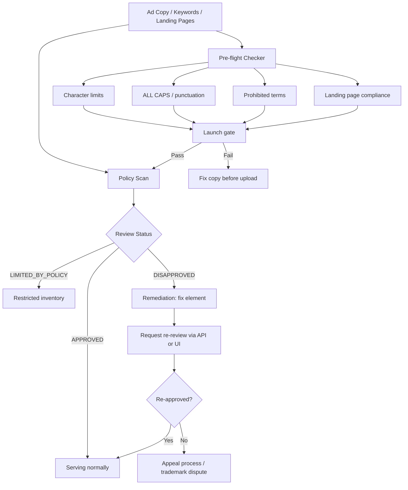

# Policy Compliance

Part of [Agent Skills™](https://github.com/itallstartedwithaidea/agent-skills) by [googleadsagent.ai™](https://googleadsagent.ai)

## Description

The Policy Compliance skill keeps ads serving by managing Google Ads policy statuses end to end. Every ad, keyword, and campaign gets a policy verdict — APPROVED, DISAPPROVED, or LIMITED_BY_POLICY — and each carries a policy_topic_entries list explaining the why. Disapproved ads stop serving entirely; limited ads serve only on restricted inventory with reduced reach. The skill maps the common violation categories to concrete fixes: misrepresentation (misleading claims, dishonest behavior), prohibited content (healthcare and drugs, financial services, alcohol and gambling where restricted), trademark infringement, and editorial quality (grammar, capitalization, excessive punctuation).

Reviews are triggered by far more than brand-new ads. Editing an existing ad, changing a final URL, or swapping a landing page can all push an entity back into review, and the rise of AI-generated ad copy has made the trigger surface much larger — generation tools happily produce "guaranteed results" and "cure everything" claims that trip misrepresentation and editorial policies at scale. Understanding what triggers review means you can screen before upload instead of discovering violations in the review queue.

When a violation lands, the remediation path is mechanical: correct the offending element, then request re-review through the UI or the Google Ads API (a mutate on the corrected entity), with typical review turnaround of one to three business days. Appeals exist when Google's decision is wrong — policy appeals and trademark dispute processes give advertisers and rights holders a formal channel. Restricted categories add a certification layer: personalized healthcare and financial products require advertiser certification in many regions before any ads can serve.

The skill also covers landing page policy issues — poor user experience and ad-to-page mismatch are policy violations, not just conversion problems — and a pre-flight checker that catches character-limit breaches, ALL CAPS, excessive punctuation, and prohibited terms before the review cycle ever runs. This skill is the compliance backbone for agencies and in-house teams scaling ad volume without scaling disapproval risk.

## Use When

- User asks "why is my ad disapproved" or "fix this policy violation"
- User mentions "limited by policy" or "restricted inventory"
- User asks about "editorial quality", "ALL CAPS", or "excessive punctuation"
- User wants a "pre-flight policy check" or "check my copy before launching"
- User mentions "trademark complaint" or "brand dispute"
- User asks about "healthcare ads certification" or "financial services restrictions"
- User says "my landing page got flagged" or "policy on landing pages"
- User wants to "appeal a policy decision" or "request re-review"
- User mentions "AI-generated ad copy" and policy risk

## Architecture



## Implementation

GAQL queries for policy status by ad group and ad level. `policy_topic_entries` is a repeated message — iterate `topic` and `type` (e.g., PROHIBITED, LIMITED, DISAPPROVED) to group violations:

```gaql
-- Policy summary by keyword / ad group (anything not fully approved)
SELECT
  campaign.name,
  ad_group.name,
  ad_group_criterion.keyword.text,
  ad_group_criterion.policy_summary.approval_status,
  ad_group_criterion.policy_summary.review_status,
  ad_group_criterion.policy_summary.policy_topic_entries
FROM ad_group_criterion
WHERE
  ad_group_criterion.type = 'KEYWORD'
  AND ad_group_criterion.policy_summary.approval_status != 'APPROVED'
  AND segments.date DURING LAST_30_DAYS

-- Ad-level policy status after launch
SELECT
  ad_group_ad.ad.id,
  ad_group_ad.ad.final_urls,
  ad_group_ad.policy_summary.approval_status,
  ad_group_ad.policy_summary.review_status,
  ad_group_ad.policy_summary.policy_topic_entries,
  campaign.name
FROM ad_group_ad
WHERE
  ad_group_ad.policy_summary.approval_status != 'APPROVED'
  AND campaign.status = 'ENABLED'
```

Pre-flight copy checker — run before any ad upload, especially AI-generated copy:

```javascript
const PROHIBITED_TERMS = [
  'guaranteed', 'cure', 'miracle', 'weight loss pill', 'free trial',
  'earn $', 'cash prize', 'without a prescription', 'no risk', 'click here'
];

function preFlightCheck(headlines, descriptions, landingPageUrl) {
  const issues = [];

  const checkText = (text, type, index) => {
    if (text.length > 30) {
      issues.push({ type: 'LENGTH', detail: `${type} ${index} exceeds 30 chars (${text.length})` });
    }
    if (text === text.toUpperCase() && text.length > 3) {
      issues.push({ type: 'ALL_CAPS', detail: `${type} ${index} is ALL CAPS: "${text}"` });
    }
    if (/[!?]{2,}/.test(text)) {
      issues.push({ type: 'EXCESSIVE_PUNCTUATION', detail: `${type} ${index} has repeated punctuation: "${text}"` });
    }
    if (/ {2,}/.test(text.trim())) {
      issues.push({ type: 'GRAMMAR', detail: `${type} ${index} contains double spaces` });
    }
    for (const term of PROHIBITED_TERMS) {
      if (text.toLowerCase().includes(term)) {
        issues.push({ type: 'PROHIBITED_TERM', detail: `${type} ${index} contains "${term}"` });
      }
    }
  };

  headlines.forEach((h, i) => checkText(h, 'headline', i));
  descriptions.forEach((d, i) => checkText(d, 'description', i));

  if (!/^https:\/\/[^\s]+\.[a-z]{2,}/i.test(landingPageUrl)) {
    issues.push({ type: 'LANDING_PAGE', detail: 'Final URL must be a valid https URL' });
  }

  return {
    verdict: issues.length === 0 ? 'PASS' : 'FAIL',
    issues,
    summary: `${headlines.length} headlines, ${descriptions.length} descriptions checked`
  };
}
```

Remediation mapper — translate policy topics into concrete fixes and trigger re-review:

```javascript
const TOPIC_FIX_MAP = {
  'Misrepresentation': 'Remove misleading claims; ensure ad matches landing page content',
  'Trademark': 'Remove trademarked terms or obtain rights-holder authorization',
  'Editorial': 'Fix grammar, capitalization, and punctuation; rewrite ALL CAPS text',
  'Healthcare': 'Complete healthcare certification or remove health claims from copy',
  'Financial': 'Complete financial services certification or remove lending/offer claims',
  'Landing page': 'Fix poor UX, pop-ups, or ad-to-page mismatch on the final URL'
};

async function remediateAndResubmit(adGroupAdId, topicEntries) {
  const fixes = topicEntries.map(t => ({
    topic: t.topic,
    type: t.type, // PROHIBITED, LIMITED, DISAPPROVED
    action: TOPIC_FIX_MAP[t.topic] || 'Review policy center for guidance'
  }));

  // After applying fixes, resubmit via GoogleAdsService mutate
  // on the corrected ad — the update triggers a fresh policy review
  const resubmitted = await updateAdGroupAd(adGroupAdId, { policyReviewRequested: true });
  return {
    fixes,
    resubmitted,
    expectedReviewTimeline: '1-3 business days',
    escalate: fixes.some(f => f.type === 'PROHIBITED' && f.topic === 'Misrepresentation')
      ? { path: 'appeal', note: 'File policy appeal if the decision is factually wrong' }
      : null
  };
}
```

## Integration with Buddy™ Agent

Policy Compliance is a standing watchdog inside the Buddy™ Agent platform. Buddy™ queries policy summaries across the account daily, and the moment an ad, keyword, or campaign flips from APPROVED to DISAPPROVED or LIMITED_BY_POLICY, it surfaces the violation with the exact topic entries and a remediation plan — before the serving loss compounds. It correlates policy flips with recent account events (copy edits, URL changes, landing page swaps) so teams understand the trigger, not just the symptom.

Buddy™ routes remediation through the other skills in the platform: the Ad Copy Generation skill rewrites violating copy with compliant alternatives, the Landing Page Audit skill validates final URLs against policy UX requirements, and the Automation Rules skill can stand up an alert that fires the instant any entity's approval status changes. For AI-generated copy pipelines, Buddy™ runs the pre-flight checker automatically at upload time and blocks anything that fails, making the review cycle a formality rather than the first line of defense.

The platform also tracks restricted-category certification status per account and flags launch plans that would hit certification walls, coordinating with the Campaign Launch Checklist skill so compliance is a launch gate instead of a launch-day surprise.

## Best Practices

1. Run the pre-flight checker on every ad before upload — never let the review cycle be your first test
2. Fix and resubmit within 48 hours of a disapproval to minimize serving downtime
3. Keep a vertical-specific blocklist of prohibited terms (healthcare, finance, gambling) and update it quarterly
4. Track policy topic entries by category monthly — recurring topics indicate a systemic copy or landing page issue
5. Never use ALL CAPS or more than one exclamation point in headlines; maintain proper grammar and punctuation
6. Reserve superlative claims ("guaranteed", "best", "#1", "cure") unless you can substantiate them
7. Mirror ad claims on the landing page — message mismatch is a misrepresentation violation
8. Complete restricted-category certification (healthcare, financial products) before launching, not after
9. Double-screen AI-generated copy with an automated check plus a human review before upload
10. Set up approval-status alert rules so the team knows the moment any entity stops serving

## Platform Compatibility

| Platform | Supported |
|----------|-----------|
| Claude Code | ✅ |
| Cursor | ✅ |
| Codex | ✅ |
| Gemini | ✅ |

## Related Skills

- [Ad Copy Generation](../ad-copy-generation/) - Generate compliant copy that passes editorial and prohibited-term checks
- [Landing Page Audit](../landing-page-audit/) - Landing page policy issues: UX quality and ad-to-page message match
- [Campaign Launch Checklist](../campaign-launch-checklist/) - Pre-flight policy checks are a mandatory launch gate
- [Automation Rules](../automation-rules/) - Alert rules that fire the moment an ad is disapproved
- [Quality Score Optimization](../quality-score-optimization/) - Editorial quality affects both policy status and relevance
- [Google Ads Audit](../google-ads-audit/) - Audit workflows surface policy risk across the whole account
- [Enhanced Conversions](../enhanced-conversions/) - Consent-mode and data-privacy configuration feeds policy readiness

## Keywords

google ads policy, policy compliance, disapproved ads, limited by policy, policy topics, misrepresentation, prohibited content, editorial quality, excessive punctuation, trademark dispute, policy appeal, re-review, restricted categories, healthcare ads certification, landing page policy, pre-flight check, ad copy checker, ai ad copy risk, policy review status, trademark infringement

---

© 2026 [googleadsagent.ai™](https://googleadsagent.ai) | [Agent Skills™](https://github.com/itallstartedwithaidea/agent-skills) | MIT License