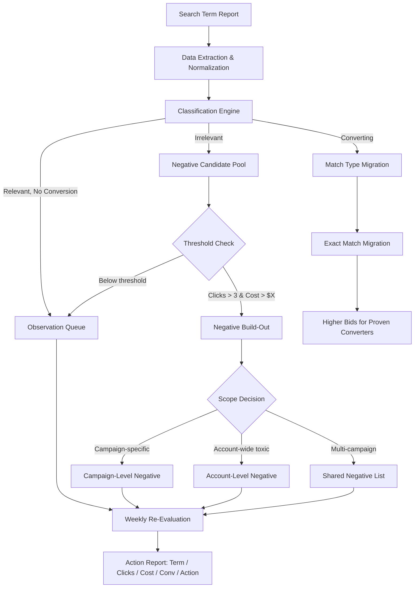

# Search Term Analysis

Part of [Agent Skills™](https://github.com/itallstartedwithaidea/agent-skills) by [googleadsagent.ai™](https://googleadsagent.ai)

## Description

The Search Term Analysis skill turns the search term report — the raw record of every query that triggered an ad — into a weekly action plan for eliminating wasted spend and finding hidden growth. Most accounts leak 10-25% of budget to irrelevant queries that broad and phrase match keywords happily accept. This skill makes that leakage visible, quantifiable, and fixable within a single work session.

Every search term is classified into one of three buckets: converting, relevant-but-not-converting, and irrelevant. Converting terms get protected and amplified through match type migration. Relevant non-converters stay under observation — they are often mid-funnel research queries that convert later or in another campaign. Irrelevant terms that burn clicks and budget without conversion intent become negatives, built out with the correct match type (phrase for multi-word offenders, exact for single semantic offenders) and the correct scope (campaign-level when the term is campaign-specific, account-level when it is toxic everywhere).

The negative build-out follows a disciplined rule set rather than gut instinct. A term earns a negative only when it crosses thresholds: typically more than a small number of clicks (3+) with zero conversions and meaningful cost (for example, $5-10+ wasted on a typical account, scaled to spend). Shared negative lists are the operational backbone — one list per theme (brand, competitor, product-line, geo-flavored terms) lets an account scale suppression across dozens of campaigns without re-entering terms everywhere.

The skill also drives expansion. Proven converters sitting in broad or phrase match get migrated to exact match with higher bids, capturing more of the demand they demonstrably convert on. For accounts spending $10k+/month, this analysis runs weekly without exception; smaller accounts can run biweekly. The output is always a table: search term, clicks, cost, conversions, action — so the work is reviewable, auditable, and executable.

## Use When

- User asks to "find wasted spend" or "clean up search terms"
- User mentions "irrelevant searches" or "my ads show for the wrong queries"
- User wants to "add negative keywords" or "build a negative keyword list"
- User asks "why is my spend high with no conversions"
- User mentions "search terms report" or "search query report"
- User wants to "expand on winning keywords" or "find new keywords from search terms"
- User asks about "match types" or "should I move keywords to exact match"
- User mentions "PMax search terms" or "search insights"

## Architecture



## Implementation

Pull the search term report with cost and conversion metrics:

```gaql
SELECT
  customer.id,
  campaign.id,
  campaign.name,
  ad_group.id,
  ad_group.name,
  search_term_view.search_term,
  metrics.impressions,
  metrics.clicks,
  metrics.cost_micros,
  metrics.conversions,
  metrics.conversions_value,
  metrics.ctr
FROM search_term_view
WHERE segments.date DURING LAST_30_DAYS
  AND metrics.impressions > 0
  AND campaign.status = 'ENABLED'
ORDER BY metrics.cost_micros DESC
```

Classification and negative build-out logic with realistic thresholds:

```javascript
function classifySearchTerm(term, config = {}) {
  const cost = term.costMicros / 1e6;
  const conversions = term.conversions || 0;

  const thresholds = {
    minClicksForNegative: config.minClicksForNegative ?? 3,
    minCostForNegative: config.minCostForNegative ?? 5,
    monthlySpendScale: config.monthlySpendScale ?? 1
  };

  const scaledCostFloor = thresholds.minCostForNegative * Math.log2(1 + thresholds.monthlySpendScale);

  if (conversions > 0) {
    return { action: 'PROTECT', label: 'CONVERTING' };
  }

  const relevant = isRelevantTerm(term.searchTerm, term.adGroupName);
  if (relevant) {
    return { action: 'WATCH', label: 'RELEVANT_NON_CONVERTING' };
  }

  const clicks = term.clicks || 0;
  if (clicks > thresholds.minClicksForNegative && cost > scaledCostFloor) {
    return { action: 'NEGATIVE', label: 'IRRELEVANT' };
  }

  return { action: 'WATCH', label: 'IRRELEVANT_LOW_VOLUME' };
}

function buildNegativeKeyword(term, scopeDecision) {
  const words = term.searchTerm.trim().split(/\s+/).length;

  return {
    keyword: term.searchTerm,
    matchType: words >= 3 ? 'PHRASE' : 'EXACT',
    level: scopeDecision,
    sharedList: recommendSharedList(term.searchTerm),
    rationale: `${term.clicks} clicks, $${(term.costMicros / 1e6).toFixed(2)} cost, 0 conversions in 30 days`
  };
}

function recommendMatchTypeMigration(convertingTerms) {
  return convertingTerms
    .filter(t => t.matchType !== 'EXACT' && t.conversions >= 2)
    .map(t => ({
      keyword: t.keyword,
      fromMatch: t.matchType,
      toMatch: 'EXACT',
      priority: t.conversionsValue / (t.costMicros / 1e6),
      bidLift: 0.2
    }))
    .sort((a, b) => b.priority - a.priority);
}

function planWeeklyReview(accountMonthlySpend) {
  return {
    cadence: accountMonthlySpend >= 10000 ? 'WEEKLY' : 'BIWEEKLY',
    scope: accountMonthlySpend >= 10000 ? 'full account' : 'top spend campaigns only',
    thresholds: accountMonthlySpend >= 10000
      ? { minClicksForNegative: 3, minCostForNegative: 5 }
      : { minClicksForNegative: 5, minCostForNegative: 10 }
  };
}
```

## Integration with Buddy™ Agent

Search Term Analysis is Buddy™ Agent's waste-detection layer. On the configured cadence — weekly for accounts above $10k/month spend, biweekly below — Buddy™ pulls the full search term report, runs the classification engine, and presents a ranked action table where every row carries a one-click action: add as negative, move to exact match, or keep watching. No term is ever added as a negative without a human approval click.

Buddy™ tracks the shared negative lists it maintains and keeps them in sync with the negative keyword workflow, deduplicating terms across lists and flagging list conflicts before they cause surprises. When a term is migrated to exact match, Buddy™ coordinates with the Bid Strategy Optimization skill so the higher-bid recommendation respects Smart Bidding guardrails rather than fighting the algorithm.

The skill also feeds the Google Ads Audit skill: Buddy™ includes the share of spend lost to irrelevant terms in every audit report, using it as a headline efficiency metric. And because search term insights now appear in Performance Max and Search, Buddy™ surfaces those insights alongside classic search term reports so the analysis covers the whole account, not just Search campaigns.

## Best Practices

1. Analyze weekly without exception for accounts spending $10k+/month; biweekly is the floor for smaller accounts
2. Only add a term as a negative after it crosses thresholds — typically 3+ clicks with zero conversions and meaningful cost; never negative on a single click
3. Use phrase match negatives for multi-word queries and exact match negatives for single semantic offenders — never broad match negatives
4. Put negatives at campaign level when the term is campaign-specific and account level when it is toxic everywhere; prefer shared negative lists for multi-campaign themes
5. Migrate proven converters (2+ conversions) from broad/phrase to exact match and raise bids ~20% to capture more of that demand
6. Never let a converting term become a negative — check conversion action attribution before suppressing anything with conversions
7. Re-evaluate relevant non-converters weekly; many are mid-funnel queries that convert in remarketing or after 7+ day lag
8. Review search term insights for Performance Max campaigns as part of the same cadence; add excluded terms from the insights page
9. Sanitize the report of brand terms and competitor terms before building negatives so you do not suppress strategic queries
10. Cap negative list growth: if a list exceeds ~1,000 terms, restructure keywords and match types rather than continuing to suppress

## Platform Compatibility

| Platform | Supported |
|----------|-----------|
| Claude Code | ✅ |
| Cursor | ✅ |
| Codex | ✅ |
| Gemini | ✅ |

## Related Skills

- [Keyword Research](../keyword-research/) - Search term analysis feeds proven queries back into keyword expansion
- [Bid Strategy Optimization](../bid-strategy-optimization/) - Clean search term data improves Smart Bidding model signals
- [Quality Score Optimization](../quality-score-optimization/) - Removing irrelevant impressions improves click-through rate and quality score
- [Google Ads Audit](../google-ads-audit/) - Wasted spend share is a headline audit metric
- [Competitor Analysis](../competitor-analysis/) - Protect brand and competitor terms from accidental negative suppression
- [Pmax Optimization](../pmax-optimization/) - Search term insights reveal what Performance Max is actually matching on
- [Budget Optimization](../budget-optimization/) - Budget freed from wasted spend funds impression-share opportunities
- [Remarketing Strategy](../remarketing-strategy/) - Relevant non-converters are remarketing audiences in waiting

## Keywords

search term report, search terms analysis, negative keywords, wasted spend, search query report, negative keyword list, shared negative lists, match type migration, exact match, phrase match, broad match, search insights, pmax search terms, keyword expansion, click waste, irrelevant searches, search term classification, spend efficiency, account cleanup

---

© 2026 [googleadsagent.ai™](https://googleadsagent.ai) | [Agent Skills™](https://github.com/itallstartedwithaidea/agent-skills) | MIT License